# 第5章 第二型曲线积分与曲面积分

> 学习目标：理解做功与通量中的方向，掌握直接计算，再依据条件选择 Green、Gauss、Stokes；会处理路径无关、投影、补线、补面与奇点。

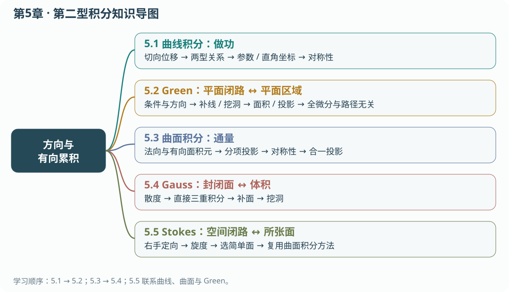

本章以本地《微积分总结》第6—13页的知识结构为主线，结合《微积分下册教材》第五章 §1—§5 补齐定义、条件、推导和例题。先读每节导图，再按正文顺序学习；完整推导和进阶方法可展开阅读。第4章的参数、面积元与二重积分是先修工具。

## 1 理解意义：变力沿有向曲线做功

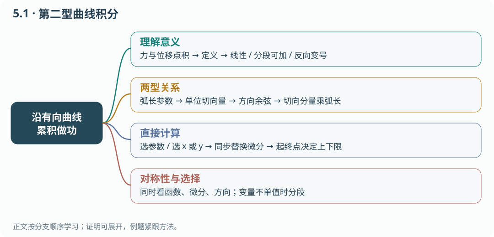

本节按“理解做功 → 联系第一型 → 化为一元定积分 → 利用对称性”学习。正文先讲平面曲线，再补充空间形式。依据《微积分总结》PDF第6页、教材第172—179页。

### 从恒力做功到曲线上的微小功

恒力 $\mathbf F=(2,0)$ 沿位移 $(1,0)$ 做功为 $2$，沿 $(0,1)$ 为 $0$，沿 $(-1,0)$ 为 $-2$。点积保留的是力沿位移方向的分量。

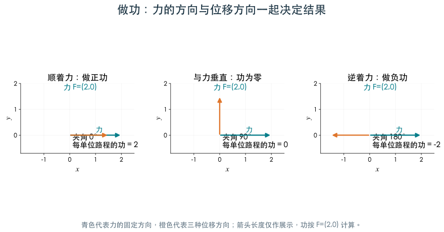

曲线上每一小段的运动方向可能不同。设 $\mathbf F=(P,Q)$，微小位移为 $d\mathbf r=(dx,dy)$，则

<!-- study:concept|第二型曲线积分：有向微小功的累积 -->

$$
dW=\mathbf F\cdot d\mathbf r=Pdx+Qdy,\qquad
W=\int_LPdx+Qdy.
$$

$P,Q$ 是力在坐标轴上的分量，$dx,dy$ 是沿行进方向的坐标增量，可以为负。空间情形增加 $Rdz$，即 $\int_\Gamma(Pdx+Qdy+Rdz)$。

<!-- /study -->

### 定义、方向与基本性质

把有向曲线按行进顺序分成小段，取各段上的点 $(\xi_i,\eta_i)$，以该点的力近似整段的力，再将功相加。最大子弧长度趋于零时的极限就是积分。分段光滑曲线上，连续的 $P,Q$ 保证该积分存在。

扩展：从分割和式写出严格定义

设分点为 $M_i=(x_i,y_i)$，按起点至终点排列，$\Delta x_i=x_i-x_{i-1}$、$\Delta y_i=y_i-y_{i-1}$，$\lambda$ 是最大子弧长度。若极限存在且与分割、取点无关，定义

$$
\int_LPdx+Qdy
=\lim_{\lambda\to0}\sum_{i=1}^n
\left[P(\xi_i,\eta_i)\Delta x_i+Q(\xi_i,\eta_i)\Delta y_i\right].
$$

不能把 $\Delta x_i,\Delta y_i$ 换成它们的绝对值；那样会改变所累积的量。

|性质|具体含义|
|---|---|
|线性|对被积表达式的加法、常数倍可以分别积分|
|分段可加|$L=L_1+L_2$ 且方向衔接，则 $\int_L=\int_{L_1}+\int_{L_2}$|
|反向变号|$-L$ 与 $L$ 方向相反，则 $\int_{-L}Pdx+Qdy=-\int_LPdx+Qdy$|
|闭曲线记号|$\oint_L$ 表示沿闭曲线积分，不意味着积分值为零|

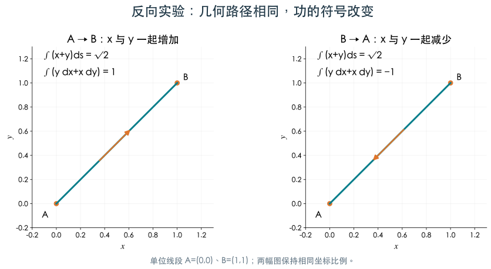

第一型的 $ds$ 是非负长度元；第二型的 $dx,dy,dz$ 保留坐标变化的符号。方向是题目数据的一部分。

## 2 两型曲线积分的关系

### 用单位切向量连接两型

沿行进方向的单位切向量为 $\mathbf T=(\cos\alpha,\cos\beta,\cos\gamma)$，其中角度分别是它与三个坐标轴正方向的夹角。

<!-- study:result|坐标微分是弧长元的有向投影 -->

$$
dx=\cos\alpha\,ds,\quad dy=\cos\beta\,ds,\quad dz=\cos\gamma\,ds,
$$

$$
\int_\Gamma Pdx+Qdy+Rdz
=\int_\Gamma(P\cos\alpha+Q\cos\beta+R\cos\gamma)ds
=\int_\Gamma\mathbf F\cdot\mathbf T\,ds.
$$

<!-- /study -->

右边是以力的切向分量为被积函数的第一型曲线积分。反向时 $ds$ 不变，但 $\mathbf T$ 反向，所以功仍然变号。方向余弦一般随位置变化，不能直接提出积分号。

扩展推导：从弧长参数、单位切向量到两型曲线积分的关系

#### 1. 用沿行进方向累计的弧长作参数

设曲线从 $A$ 指向 $B$，全长为 $\ell$。用从 $A$ 出发累计走过的弧长 $s$ 表示曲线上的位置：

$$
\mathbf r(s)=(x(s),y(s),z(s)),\qquad0\le s\le\ell.
$$

这里 $s$ 是已经走过的长度，$ds$ 是微小弧长；$dx,dy,dz$ 是这段运动在三个坐标轴方向上的有符号变化量。走了一小段正的长度，某个坐标仍然可能减小。

#### 2. 为什么对弧长求导得到单位切向量？

先在一段光滑正则曲线上取一般参数 $t$，并使 $t$ 增大时从 $A$ 向 $B$ 行进。其速度长度为

$$
\frac{ds}{dt}=\|\mathbf r'(t)\|
=\sqrt{x'(t)^2+y'(t)^2+z'(t)^2}>0.
$$

由链式法则，

$$
\frac{d\mathbf r}{ds}
=\frac{d\mathbf r/dt}{ds/dt}
=\frac{\mathbf r'(t)}{\|\mathbf r'(t)\|}.
$$

右侧把切向量除以它的长度，方向仍沿行进方向，长度则变成 $1$，所以它就是有向单位切向量：

$$
\mathbf T=\frac{d\mathbf r}{ds}
=\left(\frac{dx}{ds},\frac{dy}{ds},\frac{dz}{ds}\right),
\qquad
\left(\frac{dx}{ds}\right)^2+
\left(\frac{dy}{ds}\right)^2+
\left(\frac{dz}{ds}\right)^2=1.
$$

分段光滑曲线可以在每一段上这样推导，再把积分相加；有限个折点不影响积分。

#### 3. 方向余弦为什么等于这三个导数？

设 $\alpha,\beta,\gamma$ 分别为 $\mathbf T$ 与三个坐标轴正方向的夹角。以 $x$ 轴单位向量 $\mathbf e_x=(1,0,0)$ 为例，按点积公式，

$$
\mathbf T\cdot\mathbf e_x
=\|\mathbf T\|\,\|\mathbf e_x\|\cos\alpha
=\cos\alpha.
$$

另一方面，按分量计算同一个点积，

$$
\mathbf T\cdot\mathbf e_x
=\frac{dx}{ds}\cdot1+\frac{dy}{ds}\cdot0+\frac{dz}{ds}\cdot0
=\frac{dx}{ds}.
$$

因此 $dx/ds=\cos\alpha$；另外两条坐标轴同理，得到

$$
\frac{dx}{ds}=\cos\alpha,\qquad
\frac{dy}{ds}=\cos\beta,\qquad
\frac{dz}{ds}=\cos\gamma.
$$

也就是

$$
\boxed{dx=\cos\alpha\,ds,\quad dy=\cos\beta\,ds,\quad dz=\cos\gamma\,ds}.
$$

这三个式子表示微小位移在各坐标轴上的有向投影。例如沿途 $x$ 减小时，$dx/ds<0$，相应的 $\cos\alpha<0$，于是 $dx$ 为负，符号没有丢失。

#### 4. 将三个微分逐项代入积分

先看被积表达式：

$$
\begin{aligned}
Pdx+Qdy+Rdz
&=P\cos\alpha\,ds+Q\cos\beta\,ds+R\cos\gamma\,ds\\
&=(P\cos\alpha+Q\cos\beta+R\cos\gamma)ds.
\end{aligned}
$$

再沿整条曲线累加，就得到

$$
\boxed{\int_\Gamma Pdx+Qdy+Rdz
=\int_\Gamma(P\cos\alpha+Q\cos\beta+R\cos\gamma)ds}.
$$

如果记 $\mathbf F=(P,Q,R)$，括号里的标量正是 $\mathbf F\cdot\mathbf T$。因此这一步把第二型曲线积分化为以 $\mathbf F\cdot\mathbf T$ 为被积函数的第一型曲线积分。方向余弦随曲线上点的位置变化，一般不能当作常数提出积分号。

#### 5. 为什么右边用的是第一型积分，仍然保留方向？

第一型积分对同一个标量函数沿同一条曲线积分，与行进方向无关。但这里的标量函数包含了有向单位切向量 $\mathbf T$：反向行进时，$ds$ 不变，而 $\mathbf T$ 变为 $-\mathbf T$，所以 $\mathbf F\cdot\mathbf T$ 整体变号。

例如线段从 $(0,0,0)$ 指向 $(1,1,0)$，有 $\mathbf T=(1,1,0)/\sqrt2$，所以

$$
Pdx+Qdy=\frac{P+Q}{\sqrt2}\,ds.
$$

反向时单位切向量变成 $(-1,-1,0)/\sqrt2$，相同向量场对应的表达式变成 $-(P+Q)ds/\sqrt2$。因此第二型积分反向变号，与上面的关系式完全一致。

### 小例：同一条线段的两种累积

$L$ 从 $(0,0)$ 到 $(1,1)$，取 $x=y=t,0\le t\le1$。第一型积分为

$$
\int_L(x+y)ds=\int_0^12t\sqrt2\,dt=\sqrt2;
$$

第二型积分为

$$
\int_Ly\,dx+x\,dy=\int_0^1(t+t)dt=1.
$$

反向后两者分别为 $\sqrt2$ 和 $-1$。两种积分累积的对象不同，不能直接将 $dx,dy$ 换成 $ds$。

## 3 计算本质：化为一元定积分

### 一般参数法

<!-- study:result|替换坐标时，同步替换微分 -->

若 $x=x(t),y=y(t)$，起终点分别对应 $t=a,b$，则

$$
\int_LPdx+Qdy
=\int_a^b\left[P(x(t),y(t))x'(t)+Q(x(t),y(t))y'(t)\right]dt.
$$

空间曲线增加 $R(\mathbf r(t))z'(t)$。公式中没有弧长根号，也不对坐标导数取绝对值。

<!-- /study -->

统一步骤是：**选变量 → 写曲线方程 → 换算微分 → 按起终点定上下限 → 积分**。

### 例1 圆弧参数法：教材例1.1

计算 $\int_Lxdy-ydx$，$L$ 为圆 $x^2+(y-1)^2=1$ 上从 $O=(0,0)$ 到 $B=(1,1)$ 的右下方四分之一圆弧。

**本例知识点**：用圆的参数表达式同时代入坐标和微分；参数范围必须对应指定的弧与方向。

取 $x=\cos t,y=1+\sin t,t:-\pi/2\to0$，则 $dx=-\sin tdt,dy=\cos tdt$。因此

$$
I=\int_{-\pi/2}^0\left[\cos^2t+(1+\sin t)\sin t\right]dt
=\int_{-\pi/2}^0(1+\sin t)dt=\frac\pi2-1.
$$

若改走折线 $O\to(0,1)\to B$，竖段 $x=0,dx=0$，贡献为零；横段 $y=1,dy=0$，贡献为 $-\int_0^1dx=-1$。同一对端点的不同路径，积分一般不同。

### 以 x 或 y 为变量

|曲线表示|微分替换|一元积分|
|---|---|---|
|$y=\varphi(x),x:a\to b$|$dy=\varphi'(x)dx$|$\int_a^b[P(x,\varphi(x))+Q(x,\varphi(x))\varphi'(x)]dx$|
|$x=\psi(y),y:c\to d$|$dx=\psi'(y)dy$|$\int_c^d[P(\psi(y),y)\psi'(y)+Q(\psi(y),y)]dy$|

下限对应起点，上限对应终点，不必从小到大。若曲线不能在整段上写成所选变量的单值函数，应分段或更换变量。

### 例2 同一道抛物线题，比较选 x 与选 y

计算 $\int_Lxy\,dx$，$L:x=y^2$ 从 $A=(1,-1)$ 经原点到 $B=(1,1)$。此题来自总结第6页。

**本例知识点**：以 $y$ 为变量可以覆盖整条曲线；以 $x$ 为变量则必须区分上下两支。

以 $y$ 为变量，$x=y^2,dx=2y\,dy$，所以

$$
I=\int_{-1}^1y^2\cdot y\cdot2y\,dy=\int_{-1}^12y^4dy=\frac45.
$$

以 $x$ 为变量：下支 $y=-\sqrt x,x:1\to0$；上支 $y=\sqrt x,x:0\to1$。于是

$$
I=\int_1^0-x\sqrt x\,dx+\int_0^1x\sqrt x\,dx=\frac45.
$$

两段的 $x$ 变化方向不同；如果都写成 $0\to1$，就会错误相消。

### 例3 分段空间曲线：教材例1.3

计算 $\int_\Gamma ydx+zdy+xdz$，路径为 $A=(2,0,0)\to B=(3,4,5)\to C=(3,4,0)$ 的折线。

**本例知识点**：分段可加；某坐标恒定时，相应微分为零。

在 $AB$ 上取 $(x,y,z)=(2+t,4t,5t),t:0\to1$，得到

$$
I_{AB}=\int_0^1[4t+20t+5(2+t)]dt=\frac{49}{2}.
$$

在 $BC$ 上 $x=3,y=4,z:5\to0$，$dx=dy=0$，所以 $I_{BC}=\int_5^03dz=-15$。总和为 $I=19/2$。

## 4 计算技巧：对称性与方法选择

### 先检查函数、微分和行进方向

第二型积分的对称性要分别分析 $Pdx$、$Qdy$。函数在对称点处同号或反号之外，还需检查对应小段的坐标增量是否同号。

<!-- study:warning|几何对称并不足以直接套奇偶口诀 -->

对称性结论依赖有向路径的配对方式。开口曲线与闭曲线不能只凭同一幅对称形状套用相同口诀。稳妥方法是先参数化或投到一元积分，再判断奇偶性。

<!-- /study -->

例如关于 $y$ 轴对称的抛物线 $y=x^2$，从 $(1,1)$ 经原点走到 $(-1,1)$ 时，左右对应小段的 $dx$ 同号、$dy$ 反号。相应地，$P$ 关于 $x$ 偶时 $Pdx$ 加倍，奇时相消；$Q$ 关于 $x$ 偶时 $Qdy$ 相消，奇时加倍。这些结论针对这里的有向路径。

扩展：用同一个参数逐项验证“相消或加倍”

令 $x=t^2,y=t,t:-1\to1$。则

$$
\int_LPdx+Qdy=\int_{-1}^1[2tP(t^2,t)+Q(t^2,t)]dt.
$$

这里曲线关于 $x$ 轴对称，比较的是 $t$ 与 $-t$：若 $P(x,-y)=P(x,y)$，则 $2tP(t^2,t)$ 为奇函数，$Pdx$ 项为零；若 $Q(x,-y)=Q(x,y)$，则 $Qdy$ 项为偶函数，可取半段加倍。可见不同微分对应的结论不同。

这与正文关于 $y$ 轴对称的路径是两种情形，应根据实际图形与方向判断。

### 做题前的选择

|路径或表达式特征|优先尝试|
|---|---|
|已给参数、圆弧、空间曲线|一般参数法|
|能写成单值 $y(x)$ 或 $x(y)$|选能减少分支与计算量的变量|
|折线、不同方程拼接|分段计算，分别标明方向|
|对称路径|先检查有向配对，再利用奇偶性|
|平面闭路、疑似全微分|继续学习5.2中的 Green 与路径无关方法|

本节自检：能否解释 $dx$ 为什么可负？能否同时替换 $x,y,dx,dy$？能否从起终点确定参数上下限？

## 5 理解 Green 公式：平面边界与区域的联系

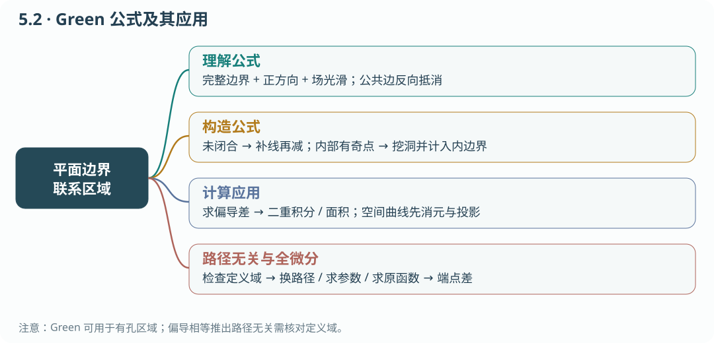

本节按“理解公式 → 构造完整边界 → 简化计算 → 路径无关与全微分”学习。依据《微积分总结》PDF第7—8页、教材第182—192页。

### 区域、完整边界与正方向

单连通域可直观理解为没有孔洞，域内闭路可以在域内缩成一点；环域、穿孔平面有孔洞。**Green 可以用于有孔区域，但必须计入全部边界**。

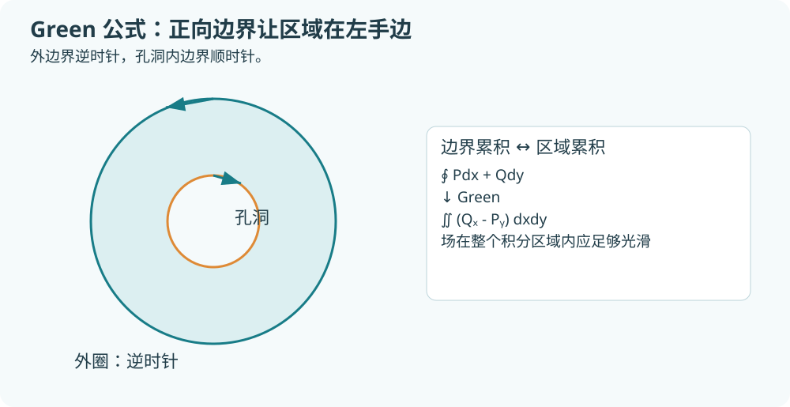

沿正向边界走，区域始终在左手边。因此外边界逆时针，孔洞边界顺时针。

<!-- study:result|Green 公式及使用条件 -->

设有界平面区域 $D$ 的边界分段光滑，$P,Q$ 在包含 $\overline D$ 的开邻域内具有连续一阶偏导数，则

$$
\oint_{\partial D^+}Pdx+Qdy
=\iint_D(Q_x-P_y)dxdy.
$$

使用前检查：**边界完整、方向正向、区域及边界附近无未处理奇点**。反向边界的积分需整体取负。

<!-- /study -->

### 为什么局部贡献最后只留下边界？

把区域分成许多小块，沿各块边界正向积分。相邻两块的公共边走向相反，积分抵消，只留下外边界及孔洞边界；$Q_x-P_y$ 对应局部环流密度。

单位圆上取 $\mathbf F=(-y,x)$。逆时针参数 $(\cos t,\sin t)$ 给 $\oint_L(-y\,dx+x\,dy)=2\pi$；圆盘内 $Q_x-P_y=2$，二重积分也为 $2\pi$。

扩展推导：从一元微积分基本定理到 Green 公式

先设 $D=\{a\le x\le b,\varphi_1(x)\le y\le\varphi_2(x)\}$。按正向边界，下边界从左向右，上边界从右向左，竖直边上 $dx=0$，因此

$$
\oint_{\partial D^+}Pdx
=\int_a^b[P(x,\varphi_1(x))-P(x,\varphi_2(x))]dx
=-\int_a^b\int_{\varphi_1(x)}^{\varphi_2(x)}P_y\,dy\,dx.
$$

类似地，对可写成 $y$ 型的区域，用水平截线有

$$
\oint_{\partial D^+}Qdy=\iint_DQ_x\,dxdy.
$$

两式相加得到 Green。一般区域分成可处理的小块，公共边反向抵消；有孔区域也用同样办法保留内边界。

## 6 构造 Green 公式：补线法与挖洞法

### 补线法：开曲线先闭合，补线积分要算回来

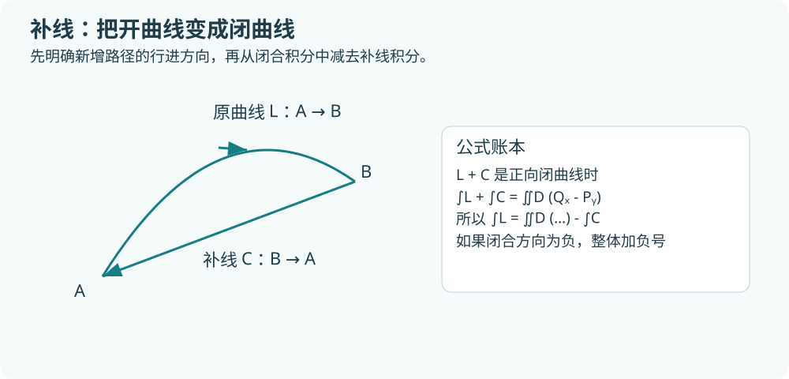

对 $L:A\to B$，补 $C:B\to A$。若 $L+C$ 为正向边界，则

$$
\int_LPdx+Qdy=\iint_D(Q_x-P_y)dxdy-\int_CPdx+Qdy.
$$

### 例1 补线积分不为零：总结中的上半圆题

$L$ 为半径 $a>0$ 的上半圆，从 $(a,0)$ 逆时针走到 $(-a,0)$，求 $\int_Lx^2dx+(y-x)dy$。

**本例知识点**：补直径形成正向闭路；补线通量不能凭几何形状假定为零。

补线 $C:y=0,x:-a\to a$。$Q_x-P_y=-1$，所以闭路积分为 $-\pi a^2/2$。在 $C$ 上 $dy=0$，但 $x^2dx$ 仍保留：

$$
\int_Cx^2dx+(y-x)dy=\int_{-a}^ax^2dx=\frac{2a^3}{3}.
$$

因此 $I=-\pi a^2/2-2a^3/3$。图中的曲线、补线均应画箭头，再写减去补线的等式。

### 挖洞法：先排除奇点，再使用定理

<!-- study:warning|偏导差为零不能掩盖函数未定义的点 -->

$$
P=-\frac y{x^2+y^2},\qquad Q=\frac x{x^2+y^2}
$$

在原点外满足 $Q_x-P_y=0$，但在原点未定义。若闭曲线围住原点，不能直接对整块内部区域使用 Green。

<!-- /study -->

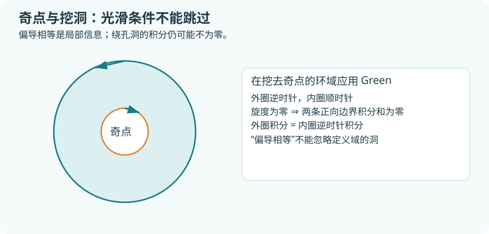

### 例2 围住原点与没有围住原点：教材例2.4

对正向简单闭曲线 $L$，计算 $\oint_L(xdy-ydx)/(x^2+y^2)$，假定 $L$ 不经过原点。

**本例知识点**：适用条件要检查整个区域；挖去小圆后，环域正向包含外圈逆时针、内圈顺时针。

若原点在外部，场在 $L$ 围成的闭区域附近光滑，Green 给积分为 $0$。若原点在内部，挖去原点附近小圆，记其逆时针边界为 $C_\varepsilon$，则

$$
\oint_L\omega-\oint_{C_\varepsilon}\omega=\iint_{D\setminus B_\varepsilon}0\,dxdy=0.
$$

取 $x=\varepsilon\cos t,y=\varepsilon\sin t,t:0\to2\pi$，得到小圆积分 $\int_0^{2\pi}dt=2\pi$，所以原积分为 $2\pi$。

进阶例题：变形分母时，如何选择便于计算的小孔？

本地第5章第二次作业计算题5：$L:(x-1)^2+y^2=4$ 取正向，求

$$
I=\oint_L\frac{xdy-ydx}{x^2+2y^2}.
$$

在原点外，令 $P=-y/(x^2+2y^2),Q=x/(x^2+2y^2)$，可算出 $Q_x-P_y=0$。原点在 $L$ 内部，挖去小椭圆 $x^2+2y^2=\varepsilon^2$。用 $x=\varepsilon\cos t,y=\varepsilon\sin t/\sqrt2$ 计算其逆时针积分，得

$$
I=\int_0^{2\pi}\frac{\varepsilon^2/\sqrt2}{\varepsilon^2}dt=\sqrt2\pi.
$$

这里外圈等于小圈逆时针积分，是将环域内边界的负号移项后的结果。

## 7 计算应用：二重积分、面积与空间曲线投影

### 闭曲线积分化为二重积分

先算 $Q_x-P_y$，再决定使用常数、对称性、极坐标或普通二重积分。偏导差不一定是常数。

### 例3 椭圆上的闭积分：本地第二次作业选择题1

$L:4x^2+y^2=8x$ 为正向边界，求 $\oint_Le^{y^2}dx+xdy$。

**本例知识点**：先求偏导，再利用区域对称性；被积函数复杂不等于转换后的积分复杂。

$Q_x-P_y=1-2ye^{y^2}$，椭圆写成 $4(x-1)^2+y^2=4$。区域关于 $x$ 轴对称，第二项关于 $y$ 为奇函数，积分为零。剩余项为椭圆面积，故 $I=\pi\cdot1\cdot2=2\pi$。

### 面积公式：反过来用边界计算面积

选 $P=-y/2,Q=x/2$，使 $Q_x-P_y=1$，得到

<!-- study:result|正向边界对应正面积 -->

$$
\operatorname{Area}(D)=\frac12\oint_{\partial D^+}(xdy-ydx)
=\oint_{\partial D^+}xdy=-\oint_{\partial D^+}ydx.
$$

有孔区域需使用全部正向边界；反向时右侧为负的有向面积。

<!-- /study -->

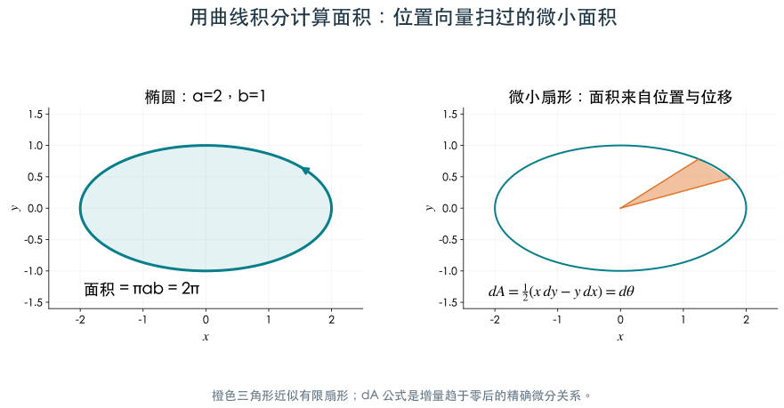

例如 $x=a\cos t,y=b\sin t,t:0\to2\pi$，$xdy-ydx=abdt$，故椭圆面积为 $\pi ab$。

### 空间曲线先消元，再对投影曲线用 Green

若曲线约束可写为 $z=g(x,y)$，代入时必须同时写 $dz=g_xdx+g_ydy$，先把空间积分重写为投影曲线上的 $\widetilde Pdx+\widetilde Qdy$。需核对投影的行进方向与覆盖次数；本节例题中投影是一次覆盖的简单闭曲线。

### 例4 球面与平面的交线：总结中的投影题

$\Gamma$ 为 $x^2+y^2+z^2=2az$ 与 $x+z=a$ 的交线，$a>0$，从 $+z$ 侧看逆时针，求 $\oint_\Gamma ydx+zdy+xdz$。

**本例知识点**：先用约束替换坐标和微分，再将平面闭路积分化为二重积分。

由 $z=a-x$ 得 $dz=-dx$；代入球面得投影椭圆 $L:2x^2+y^2=a^2$，方向为逆时针。因此

$$
I=\oint_L(y-x)dx+(a-x)dy
=\iint_D[-1-1]dxdy
=-2\pi\frac a{\sqrt2}a=-\sqrt2\pi a^2.
$$

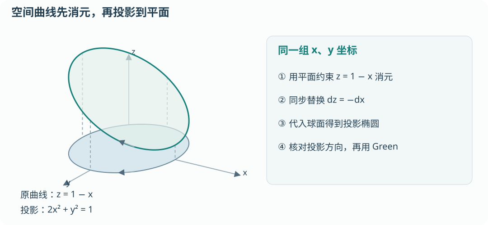

图中投影保留 $x,y$ 坐标；同时替换 $dz$ 才能保证新表达式等于原积分。

## 8 路径无关：从两条路径到闭路

### 判定条件与等价关系

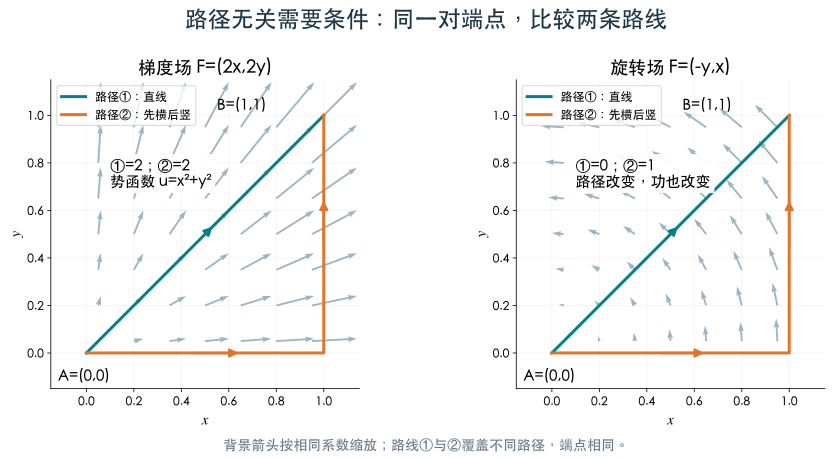

路径无关表示：在指定定义域内，固定起终点后，所有允许路径的积分相同。只检查两条路径恰好相等，并不能证明路径无关。

<!-- study:concept|路径无关、闭路为零、全微分与梯度 -->

在连通开域内，对连续场，“任意闭路积分为零”“积分与路径无关”“存在单值 $u$ 使 $du=Pdx+Qdy$”相互等价；最后一项也可写为 $\nabla u=(P,Q)$。

若域进一步单连通且 $P,Q$ 一阶连续可微，则上述条件又等价于 $P_y=Q_x$。

<!-- /study -->

在穿孔域中，偏导相等未必推出路径无关；例2就是反例。单连通是常用的充分条件框架，不是所有势函数存在的必要条件；若已直接构造出单值势函数，就可以使用端点公式。

扩展：为什么“任意闭路为零”能推出“两条路径积分相等”？

设 $L_1,L_2$ 都从 $A$ 到 $B$。把 $L_1$ 与反向的 $L_2$ 拼成闭路，有

$$
0=\oint_{L_1+(-L_2)}\omega=\int_{L_1}\omega-\int_{L_2}\omega.
$$

所以两条路径积分相等。反过来，若路径无关，一条从 $A$ 出发又回到 $A$ 的闭路可与常值路径比较，积分为零。

固定基点 $A$，定义 $u(x,y)=\int_A^{(x,y)}\omega$。路径无关保证该函数单值；比较一个短水平段或短竖直段的积分，可得 $u_x=P,u_y=Q$。

### 例5 换成简单路径：教材例2.5

$L$ 为 $(x-2)^2+y^2=4$ 的上半圆，顺时针从 $(0,0)$ 到 $(4,0)$，求

$$
\int_L(1+xe^{2y})dx+(x^2e^{2y}-y)dy.
$$

**本例知识点**：先确认整个定义域满足判定条件，再用同起终点的简单路径替换。

$P_y=2xe^{2y}=Q_x$，场在全平面一阶连续可微，故路径无关。改走 $y=0,x:0\to4$，$dy=0$，于是 $I=\int_0^4(1+x)dx=12$。

## 9 全微分的题型：求参数、求原函数与方程

### 求参数：利用偏导相等建立恒等式

例如总结中的表达式

$$
\omega=\frac{(x+ky)dx+y\,dy}{(x+y)^2},\quad x+y\ne0.
$$

若它是全微分，则 $P_y=Q_x$。计算

$$
P_y=\frac{(k-2)x-ky}{(x+y)^3},\qquad Q_x=-\frac{2y}{(x+y)^3}.
$$

比较系数得 $k=2$。定义域的两个半平面分别单连通，可验证该值充分；也可直接取 $u=\ln|x+y|-y/(x+y)$，求导得所需的 $P,Q$。

### 求原函数：三种写法解决同一个问题

|方法|操作|注意|
|---|---|---|
|先积分再补函数|由 $u_x=P$ 积分得 $u=\int Pdx+g(y)$，再用 $u_y=Q$ 确定 $g$|积分“常数”可以依赖 $y$|
|沿折线积分|从基点先水平再竖直，累加两段积分|基点及整条折线必须位于定义域内|
|观察凑全微分|识别乘积、复合函数的微分|求导核验，防止漏项|

<!-- study:result|原函数与端点计算公式 -->

$$
du=Pdx+Qdy\quad\Longrightarrow\quad\int_A^BPdx+Qdy=u(B)-u(A).
$$

若折线 $(x_0,y_0)\to(x,y_0)\to(x,y)$ 全在路径无关的定义域内，则可取

$$
u(x,y)=\int_{x_0}^xP(\xi,y_0)d\xi+\int_{y_0}^yQ(x,\eta)d\eta+C.
$$

<!-- /study -->

### 例6 求原函数：教材例2.6

证明 $(2x+\sin y)dx+x\cos y\,dy$ 为全微分并求原函数。

**本例知识点**：判定全微分后，用另一个偏导补全积分产生的未知函数。

$P_y=\cos y=Q_x$，定义域为全平面。由 $u_x=2x+\sin y$ 得 $u=x^2+x\sin y+g(y)$。再由 $u_y=x\cos y+g'(y)=Q$ 得 $g'=0$，所以 $u=x^2+x\sin y+C$。直接求微分可以复核两项。

### 全微分方程：从求原函数到求解

若方程 $Pdx+Qdy=0$ 的左侧恰为 $du$，则解曲线满足 $u(x,y)=C$。例如总结中的

$$
ye^{y^2}dx+(xe^{y^2}+2xy^2e^{y^2})dy=0
$$

左侧等于 $d(xye^{y^2})$，所以隐式解为 $xye^{y^2}=C$。

作业衔接：更复杂的原函数与空间中的全微分

本地第二次作业计算题3中，$P=2xy^3-y^2\cos x$，$Q=1-2y\sin x+3x^2y^2$。先积分再补函数可得

$$
u=x^2y^3-y^2\sin x+y.
$$

从 $(0,0)$ 到 $(\pi/2,1)$ 的积分为 $\pi^2/4$。

空间中同理：若 $du=Pdx+Qdy+Rdz$，则积分为 $u(B)-u(A)$。本地计算题1中

$$
(x^2-yz)dx+(y^2-xz)dy+(z^2-xy)dz
=d\left(\frac{x^3+y^3+z^3}{3}-xyz\right).
$$

沿螺线从 $(1,0,0)$ 到 $(1,0,2\pi)$，积分为 $8\pi^3/3$。这里用直接构造原函数完成验证。

### 方法选择

闭路且场光滑时比较 Green 与直接计算；开路可比较补线与路径无关；有奇点先检查定义域。换路径不需要减去“新增路径”，补线闭合则必须减去补线积分：两种操作的依据不同。

## 10 理解通量：曲面的侧与法向

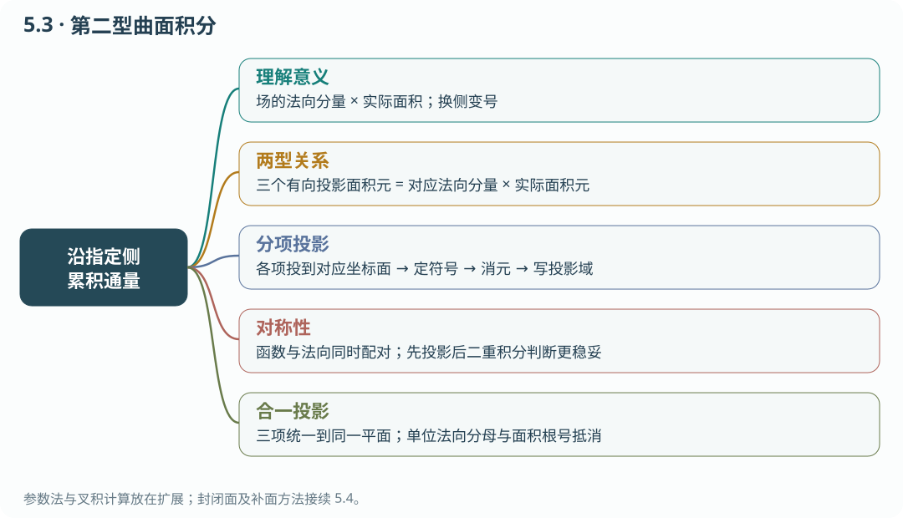

本节按“指定侧 → 理解有向投影 → 分项计算 → 对称性 → 合一计算”学习。依据《微积分总结》PDF第9—10页、教材第194—204页。

### 从流体穿过小平面块理解通量

设 $\mathbf F=(P,Q,R)$ 是流速，曲面取定侧的单位法向量为 $\mathbf n$。穿过小块的有向体积流量是

<!-- study:concept|通量只保留场的法向分量 -->

$$
d\Phi=\mathbf F\cdot\mathbf n\,dS,\qquad
\Phi=\iint_\Sigma\mathbf F\cdot\mathbf n\,dS.
$$

$dS$ 是实际面积元；$\mathbf F\cdot\mathbf n$ 是法向分量。沿所选法向穿过为正，反向穿过为负，相切时为零。若 $\mathbf F$ 为速度，这给体积流量；质量流量应使用质量通量场 $\rho\mathbf F$，密度为1时二者数值相同。

<!-- /study -->

例如 $z=x+y$ 在单位方形上方的斜面，$\mathbf F=(0,0,1)$。上侧单位法向为 $(-1,-1,1)/\sqrt3$，实际面积为 $\sqrt3$，通量是 $(1/\sqrt3)\sqrt3=1$。换成下侧后为 $-1$。

### 上下侧、内外侧与基本性质

|指定侧|判断方式|
|---|---|
|上侧、下侧|分别看 $n_z>0$、$n_z<0$|
|朝正 x、正 y 方向的一侧|分别看 $n_x>0$、$n_y>0$|
|封闭曲面外侧、内侧|法向分别指向所围立体之外、之内|

法向是垂直于曲面的方向，上侧法向不一定竖直。圆柱侧面的外侧通常沿径向，不能统一称为上侧。

第二型曲面积分对被积场线性；曲面分片且侧相容时可相加；**换侧后积分整体变号**。

扩展：什么叫可定向曲面？为什么要选单位法向？

可定向曲面能连续选取一致的单位法向；本节讨论分片光滑、可定向的曲面。莫比乌斯带无法连续选取全局一致的法向，不在本节全局通量公式的直接适用范围内。

单位法向只表示方向，长度为1。若使用未单位化法向 $\mathbf N$，应先除以 $\|\mathbf N\|$ 才能与实际面积元 $dS$ 配合。合一投影中使用的则是乘积 $\mathbf n\,dS$，它可以直接写成未单位化向量乘投影面积元，后面会推导。

## 11 有向投影面积元与两型曲面积分的关系

### 三个方向余弦对应三个投影

设 $\mathbf n=(\cos\alpha,\cos\beta,\cos\gamma)$，夹角分别相对坐标轴正方向。小曲面块的投影面积绝对值是实际面积乘夹角余弦的绝对值；有向投影的符号跟相应法向分量一致。

<!-- study:result|两型关系的三个基本等式 -->

$$
dy\,dz=\cos\alpha\,dS,\quad dz\,dx=\cos\beta\,dS,\quad dx\,dy=\cos\gamma\,dS,
$$

$$
\iint_\Sigma P\,dy\,dz+Q\,dz\,dx+R\,dx\,dy
=\iint_\Sigma(P\cos\alpha+Q\cos\beta+R\cos\gamma)dS.
$$

这里左侧的面积元带有方向；右侧 $dS$ 非负，方向已包含在余弦中。两边都表示 $\iint_\Sigma\mathbf F\cdot\mathbf n\,dS$。

<!-- /study -->

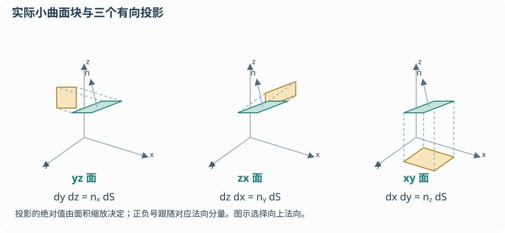

扩展推导：为什么投影面积等于法向分量乘实际面积？

用切平面上的两条小边向量 $\mathbf a,\mathbf b$ 近似曲面小块。叉积 $\mathbf a\times\mathbf b$ 垂直于小块，其长度是平行四边形面积，方向按所选侧调整。其三个分量为

$$
(a_yb_z-a_zb_y,\ a_zb_x-a_xb_z,\ a_xb_y-a_yb_x).
$$

第三分量就是两条边投到 $xy$ 面后组成的有向平行四边形面积；另一方面，该分量也等于 $\|\mathbf a\times\mathbf b\|\cos\gamma$。极限下得到 $dx\,dy=\cos\gamma\,dS$。另外两项同理。

再将三个等式代入 $Pdy\,dz+Qdz\,dx+Rdx\,dy$，合并并沿曲面积分，就得到两型关系。

|比较|第一型曲面积分|第二型曲面积分|
|---|---|---|
|累积对象|标量函数乘实际面积|向量场的法向分量乘实际面积|
|面积元|$dS$|有向 $dy\,dz,dz\,dx,dx\,dy$，或 $\mathbf n\,dS$|
|换侧|固定标量函数时不变|变号|
|方向信息|不需要选侧|必须保留在法向或有向面积元中|

## 12 分项投影法：各项投到对应坐标面

### 三种投影与符号

教材称“分面投影法”，即三类积分项分别投到对应坐标面；遇到多值曲面时还需分片。

|积分项|曲面表示与投影域|变成普通二重积分|
|---|---|---|
|$Pdy\,dz$|$x=h(y,z),D_{yz}$|$\pm\iint_{D_{yz}}P(h(y,z),y,z)dy\,dz$，符号看 $n_x$|
|$Qdz\,dx$|$y=k(z,x),D_{zx}$|$\pm\iint_{D_{zx}}Q(x,k(z,x),z)dz\,dx$，符号看 $n_y$|
|$Rdx\,dy$|$z=g(x,y),D_{xy}$|$\pm\iint_{D_{xy}}R(x,y,g(x,y))dx\,dy$，符号看 $n_z$|

右侧已经是普通的无向面积积分，符号在前面单独处理。步骤是：**看积分项 → 选对应投影 → 判断侧 → 消元 → 写投影域 → 积分**。

### 例1 平面下侧的单项积分：本地第三次作业选择题2

$\Sigma:x+y+z=1$ 在第一卦限取下侧，求 $\iint_\Sigma zdxdy$。

**本例知识点**：$dxdy$ 项投到 $xy$ 面；下侧的有向投影取负。

投影 $D:x,y\ge0,x+y\le1$，代入 $z=1-x-y$，有

$$
I=-\int_0^1\int_0^{1-x}(1-x-y)dy\,dx=-\frac16.
$$

### 坐标恒定与零贡献

若 $n_z=0$，则 $Rdxdy=Rn_zdS=0$；例如竖直柱面侧面上该项为零。同理，$n_x=0$ 时 $Pdy\,dz$ 为零，$n_y=0$ 时 $Qdz\,dx$ 为零。判断依据是该项对应的法向分量。

### 例2 六个面的贡献：教材例3.1

$\Sigma$ 是单位立方体 $[0,1]^3$ 的全部外表面，求 $\iint_\Sigma xyz\,dy\,dz$。

**本例知识点**：单项积分只保留对应法向分量非零的面；两个平行面的符号由外法向决定。

$y=0,1$ 与 $z=0,1$ 四个面上 $n_x=0$，贡献为零。面 $x=1$ 的 $n_x=1$，积分为 $\int_0^1\int_0^1yz\,dy\,dz=1/4$；面 $x=0$ 的 $n_x=-1$，但代入后 $xyz=0$，贡献为零。总和为 $1/4$。

### 例3 球面投影为什么要分上下两片？

单位球面 $\Sigma$ 取外侧，求 $\iint_\Sigma zdxdy$。

**本例知识点**：同一圆盘投影对应上下两片曲面；两片法向符号与函数符号都要保留。

在 $D:x^2+y^2\le1$ 上，上半球 $z=\sqrt{1-x^2-y^2}$，下半球 $z=-\sqrt{1-x^2-y^2}$，所以

$$
I=\iint_D\sqrt{1-x^2-y^2}dxdy
-\iint_D(-\sqrt{1-x^2-y^2})dxdy
=2\cdot2\pi\int_0^1r\sqrt{1-r^2}dr=\frac{4\pi}{3}.
$$

不能只在圆盘上代入一个 $z$ 分支，也不能因 $z$ 关于上下半球反号就认定相消。

## 13 对称性：同时检查函数与法向

### 从上下半球看“偶零奇倍”的来源

设曲面关于 $xy$ 面对称，且所选侧在反射下相容，例如关于该面对称的封闭曲面取外侧。上下对应点的 $n_z$ 反号，而 $dS$ 相同。对单项 $Rdxdy=Rn_zdS$：

<!-- study:result|有向面积元也参与对称性配对 -->

- 若 $R(x,y,-z)=R(x,y,z)$，上下贡献相消。
- 若 $R(x,y,-z)=-R(x,y,z)$，上下贡献相同，可用上半片积分的两倍。

上述结论要求法向在反射下按所述方式配对；只看曲面形状和函数奇偶性不够。

<!-- /study -->

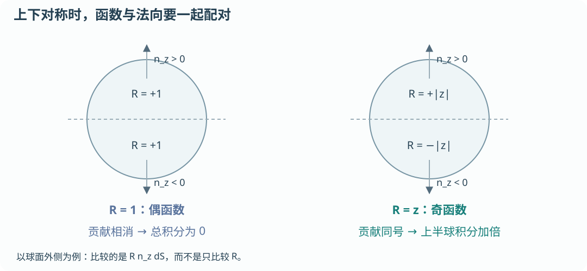

例3中 $R=z$ 为奇函数，且 $n_z$ 也反号，乘积同号，因此加倍。若改成 $R=1$，函数同号而法向反号，总积分为零。其他坐标面可用同样方法分析对应的积分项。

更稳妥的计算策略是先投影，写成带正确正负号的普通二重积分，再利用投影区域的奇偶性和轮换对称性。

## 14 合一投影法：三项统一到一个坐标面

### 从单位法向与实际面积元得到公式

对 $z=g(x,y)$ 的上侧，法向与实际面积元分别为

$$
\mathbf n=\frac{(-g_x,-g_y,1)}{\sqrt{1+g_x^2+g_y^2}},\qquad
dS=\sqrt{1+g_x^2+g_y^2}dxdy.
$$

<!-- study:result|合一投影：根号抵消，三个分量统一计算 -->

$$
\mathbf n\,dS=(-g_x,-g_y,1)dxdy,
$$

$$
I=\iint_D\left[-P(x,y,g)g_x-Q(x,y,g)g_y+R(x,y,g)\right]dxdy.
$$

下侧将整个表达式取负。所有 $z$ 均需用 $g(x,y)$ 替换，不再额外乘面积根号。

<!-- /study -->

扩展推导：法向怎么求？为什么可以把三项放到同一平面？

把曲面写成 $H(x,y,z)=z-g(x,y)=0$，梯度 $\nabla H=(-g_x,-g_y,1)$ 垂直于曲面，第三分量为正，所以指向上侧。除以它的长度即得到单位法向。

把两型关系逐项写成 $Pn_xdS+Qn_ydS+Rn_zdS$，再代入单位法向和 $dS$。每一项的分母都与面积根号相消，分别成为 $-Pg_xdxdy,-Qg_ydxdy,Rdxdy$，三项自然落在同一投影域中。

若投到其他坐标面，$x=h(y,z)$ 朝正 $x$ 一侧用 $\mathbf n\,dS=(1,-h_y,-h_z)dydz$；$y=k(z,x)$ 朝正 $y$ 一侧用 $\mathbf n\,dS=(-k_x,1,-k_z)dzdx$。投影为多值时需分片，不能用一个分支覆盖整面。

### 例4 同一锥面：分项投影与合一投影比较（教材例3.3）

$\Sigma:z=\sqrt{x^2+y^2},0\le z\le h$，取相对锥内立体的外侧，即下侧，计算 $\iint_\Sigma xdydz+ydzdx+zdxdy$。

**本例知识点**：合一投影避免三项分别求曲面分支；外侧在本题中对应下侧。锥顶一个点不影响积分，计算可在去掉锥顶的光滑部分进行。

分项投影时，$xdy\,dz$ 项在前后两片上贡献同号，得到

$$
I_x=2\int_0^h\int_{-z}^z\sqrt{z^2-y^2}\,dy\,dz=\frac{\pi h^3}{3}.
$$

同理 $I_y=\pi h^3/3$。第三项下侧取负，$I_z=-2\pi\int_0^hr^2dr=-2\pi h^3/3$，所以 $I=0$。

合一投影时，记 $r=\sqrt{x^2+y^2}$，下侧向量面积元为 $(x/r,y/r,-1)dxdy$，点积为

$$
x\frac xr+y\frac yr-z=\frac{x^2+y^2}{r}-r=0.
$$

于是立即得到 $I=0$。几何上，场 $(x,y,z)$ 沿锥面母线，与侧面相切，通量为零。

### 例5 抛物面下侧：教材例3.4

$\Sigma:z=(x^2+y^2)/2,0\le z\le2$ 取下侧，求 $\iint_\Sigma(z^2+x)dydz-zdxdy$。

**本例知识点**：下侧整体变号，代入曲面方程后再使用投影域对称性与极坐标。

$D:x^2+y^2\le4$，下侧向量面积元为 $(x,y,-1)dxdy$，所以

$$
I=\iint_D[x(z^2+x)+z]dxdy
=\iint_D\left[\frac{x(x^2+y^2)^2}{4}+x^2+\frac{x^2+y^2}{2}\right]dxdy.
$$

第一项关于 $x$ 为奇函数，积分为零；圆盘内 $\iint_Dx^2dxdy=\frac12\iint_D(x^2+y^2)dxdy$。故

$$
I=\iint_D(x^2+y^2)dxdy=2\pi\int_0^2r^3dr=8\pi.
$$

扩展：参数曲面法，以及叉积逐分量的计算

对 $\mathbf r(u,v)$，若 $\mathbf r_u\times\mathbf r_v$ 指向指定侧，则

$$
I=\iint_E\mathbf F(\mathbf r(u,v))\cdot(\mathbf r_u\times\mathbf r_v)dudv.
$$

方向相反则整体取负；叉积不取长度。第一型面积元才使用 $\|\mathbf r_u\times\mathbf r_v\|dudv$。

例如圆柱侧面 $x^2+y^2=a^2,0\le z\le h$ 取外侧，$\mathbf F=(x,y,z)$。令 $\mathbf r(\theta,v)=(a\cos\theta,a\sin\theta,v)$，则

$$
\mathbf r_\theta=(-a\sin\theta,a\cos\theta,0),\quad\mathbf r_v=(0,0,1).
$$

按 $(a_2b_3-a_3b_2,a_3b_1-a_1b_3,a_1b_2-a_2b_1)$ 展开：

$$
\mathbf r_\theta\times\mathbf r_v
=(a\cos\theta\cdot1-0,\ 0-(-a\sin\theta)\cdot1,\ 0-0)
=(a\cos\theta,a\sin\theta,0).
$$

它沿径向向外，方向正确。点积为 $a^2$，故 $I=\int_0^h\int_0^{2\pi}a^2d\theta dv=2\pi a^2h$。场的 $z$ 分量在侧面上没有法向贡献。

### 方法选择与自检

单项优先考虑对应平面的分项投影；多项且曲面能方便写成单值图形时比较合一投影；柱面等参数简单时可用参数法。若曲面封闭或易补成封闭面，继续学习5.4的 Gauss 方法。

每题复核：侧是否明确？是否漏分支？曲面变量是否全部替换？是否多乘了面积根号？

## 15 理解 Gauss 公式：封闭曲面与所围体积

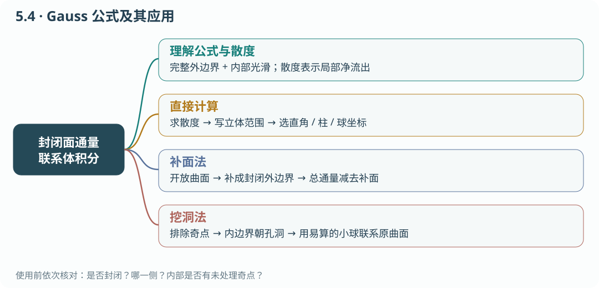

本节按“理解净流出 → 核对封闭外侧 → 直接化体积分 → 补面或挖洞”学习。依据《微积分总结》PDF第11—12页、教材第206—212页。

### 从第二型曲面积分到三重积分

<!-- study:result|Gauss 公式：完整封闭边界，取外侧 -->

设空间有界区域 $\Omega$ 的边界分片光滑并取外侧，$\mathbf F=(P,Q,R)$ 在包含 $\overline\Omega$ 的开邻域内一阶连续可微，则

$$
\iint_{\partial\Omega}Pdy\,dz+Qdz\,dx+Rdx\,dy
=\iiint_\Omega(P_x+Q_y+R_z)dV.
$$

$\partial\Omega$ 必须是全部边界；整体取内侧时，右侧加负号。有空腔时，内边界相对材料区域的外法向指向空腔。

<!-- /study -->

### 散度是什么？

<!-- study:concept|散度描述单位体积的局部净流出 -->

$$
\operatorname{div}\mathbf F=\nabla\cdot\mathbf F=P_x+Q_y+R_z.
$$

正值对应局部净流出，负值对应净流入，零表示流入流出平衡，不表示场本身为零。Gauss 把内部各点的净流出累加，等于外表面的总通量。

<!-- /study -->

图中只画 $z=0$ 的截面，散度仍按三维场计算。$(x,y,z)$ 的散度为3，$(x,-y,0)$ 的散度为0，$(-x,-y,-z)$ 的散度为 $-3$。

扩展推导：为什么公共面抵消？如何从一个分量得到 Gauss？

若 $\Omega$ 可表示为 $z_1(x,y)\le z\le z_2(x,y)$，底面投影为 $D$，则

$$
\iiint_\Omega R_zdV
=\iint_D[R(x,y,z_2)-R(x,y,z_1)]dxdy.
$$

外侧上表面的 $Rdxdy$ 为正向投影，下表面为负向投影，侧面在这一项中的贡献为零，所以右侧等于 $\iint_{\partial\Omega}Rdxdy$。另外两项同理，相加得到公式。

一般立体可以分块处理；相邻小块公共面的外法向相反，内部通量成对抵消，只留下完整外边界。

## 16 直接计算：求散度后选择体积分坐标

### 计算流程

**确认全部封闭面 → 调整为外侧 → 求散度 → 写出立体 → 选坐标 → 积分**。散度为常数时可直接乘体积；散度不是常数时仍需积分。

### 例1 球面外侧与内侧

半径 $a$ 的球面，场 $\mathbf F=(x,y,z)$，求通量。

**本例知识点**：散度为常数时，将曲面通量转成常数乘体积；内侧整体变号。

散度为3，外侧通量为 $3\cdot4\pi a^3/3=4\pi a^3$；内侧为 $-4\pi a^3$。在球面上也有 $\mathbf F\cdot\mathbf n=a$，直接乘球面积可复核外侧结果。

### 例2 半球体的全部外表面：教材例4.1

$\Sigma$ 是上半球体 $x^2+y^2+z^2\le a^2,z\ge0$ 的全部外表面，求

$$
I=\iint_\Sigma xz^2dy\,dz+(x^2y-z^3)dz\,dx+(2xy+y^2z)dx\,dy.
$$

**本例知识点**：先识别全部边界，求散度后用球坐标；体积元含雅可比因子。

$P_x=z^2,Q_y=x^2,R_z=y^2$，故散度为 $x^2+y^2+z^2=r^2$。取球坐标

$$
x=r\sin\varphi\cos\theta,\quad y=r\sin\varphi\sin\theta,\quad z=r\cos\varphi,
$$

范围 $0\le r\le a,0\le\varphi\le\pi/2,0\le\theta\le2\pi$，$dV=r^2\sin\varphi\,drd\varphi d\theta$，所以

$$
I=\int_0^{2\pi}\int_0^{\pi/2}\int_0^ar^4\sin\varphi\,drd\varphi d\theta=\frac{2\pi a^5}{5}.
$$

如果题目只指上半球曲面，就要另外检查底盘贡献；本题底盘上 $R=2xy$，朝下通量为 $-\iint_D2xy\,dxdy=0$，因此两种表述在本题中恰好同值，理由应写出。

### 常用体积元

|立体特征|坐标与体积元|常见范围|
|---|---|---|
|直角边界|$dV=dxdydz$|按截面确定|
|绕 z 轴对称|柱坐标 $dV=r\,drd\theta dz$|$r,\theta$ 由投影决定，$z$ 由上下曲面决定|
|球或球壳|球坐标 $dV=r^2\sin\varphi\,drd\varphi d\theta$|$\varphi$ 是与正 z 轴的夹角|

坐标选择取决于散度和立体的共同形状，不取决于原来的曲面方程看起来是否复杂。

## 17 补面法：开放曲面先补成完整外边界

### 补面的方向与积分等式

若 $\Sigma+B=\partial\Omega$，且两部分均按 $\Omega$ 的外侧取向，则

<!-- study:result|原曲面等于封闭面减去补面 -->

$$
\iint_\Sigma\mathbf F\cdot\mathbf n\,dS
=\iiint_\Omega\operatorname{div}\mathbf FdV
-\iint_B\mathbf F\cdot\mathbf n\,dS.
$$

先写这个等式再代入数值。上方立体的底盘，外法向朝下；补面通量可能为正、为负或为零。

<!-- /study -->

### 例3 抛物面补底盘：教材例4.2

$\Sigma:z=1-x^2-y^2\ge0$ 取上侧，求

$$
I=\iint_\Sigma(y^2-x)dydz+(z^2-y)dzdx+(x^2-z)dxdy.
$$

**本例知识点**：原曲面不是封闭面；补面外法向和“减去补面”是两次独立的符号判断。

补 $B:z=0,x^2+y^2\le1$，取下侧，与原面围成 $0\le z\le1-r^2$。散度为 $-3$，体积为 $2\pi\int_0^1(1-r^2)rdr=\pi/2$，所以封闭面通量为 $-3\pi/2$。

补面上 $dxdy$ 取负，$R=x^2$，故

$$
I_B=-\iint_Dx^2dxdy
=-\int_0^{2\pi}\int_0^1r^3\cos^2\theta\,drd\theta=-\frac\pi4.
$$

于是 $I=-3\pi/2-(-\pi/4)=-5\pi/4$。补面的负号不能在移项时丢失。

补充例题：半球面补盘，补面通量为什么不是零？

上半球 $x^2+y^2+z^2=a^2,z\ge0$ 取外侧，$\mathbf F=(x,y,z+1)$。散度为3，半球体内积分为 $2\pi a^3$。底盘法向为 $(0,0,-1)$，场的竖直分量为1，故补面通量 $-\pi a^2$。

因此原半球面通量为 $2\pi a^3+\pi a^2$。不能因为补面位于 $z=0$ 就认定其通量为零，应代入完整的 $R$。

## 18 挖洞法：排除内部奇点

### 散度为零仍可能有非零通量

<!-- study:warning|使用 Gauss 要检查立体内部，不只检查表面 -->

$$
\mathbf F=\frac{(x,y,z)}{(x^2+y^2+z^2)^{3/2}}
$$

在原点外散度为零，在原点未定义。若封闭面包围原点，不能直接对整块内部使用 Gauss。

<!-- /study -->

### 例4 椭球外侧的径向通量：教材例4.3

$\Sigma:x^2/a^2+y^2/b^2+z^2/c^2=1$ 取外侧，$a,b,c>0$，求上述场的通量。

**本例知识点**：挖去小球后，在光滑的剩余区域用 Gauss；小球是空腔，其法向相对剩余区域指向球心。

记 $r=\sqrt{x^2+y^2+z^2}$，在 $r>0$ 处有

$$
P_x=r^{-3}-3x^2r^{-5},\quad Q_y=r^{-3}-3y^2r^{-5},\quad R_z=r^{-3}-3z^2r^{-5},
$$

所以散度为 $3r^{-3}-3r^2r^{-5}=0$。在椭球内部挖去小球 $r\le\varepsilon$，记小球向外法向为 $\mathbf n_+$。剩余区域内边界法向为 $-\mathbf n_+$，Gauss 给

$$
\iint_\Sigma\mathbf F\cdot\mathbf n\,dS
-\iint_{S_\varepsilon}\mathbf F\cdot\mathbf n_+\,dS=0.
$$

小球上 $\mathbf F\cdot\mathbf n_+=1/\varepsilon^2$，面积 $4\pi\varepsilon^2$，因此原积分为 $4\pi$。椭球形状的复杂度没有进入最后计算。

### 方法选择与自检

|情形|操作|
|---|---|
|完整封闭面、内部光滑|直接用 Gauss，外侧为正，内侧取负|
|有开口、容易补简单面|补面后用 Gauss，再减去补面|
|内部有孤立奇点|先挖洞，在剩余光滑区域用 Gauss|
|直接投影更短|仍可用5.3，不必为用定理而补复杂面|

自检：题目给的是曲面还是立体的全部边界？法向是相对哪个立体的外侧？补面、孔洞的积分是否完整计入？

## 19 理解 Stokes 公式：空间闭曲线与所张曲面

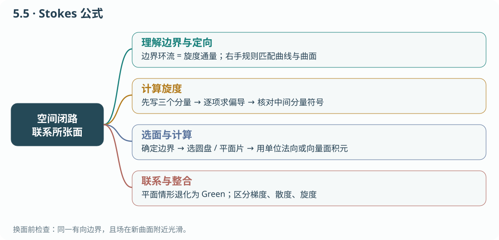

本节按“理解边界关系 → 匹配右手方向 → 计算旋度 → 选择简单曲面”学习。依据《微积分总结》PDF第13页、教材第213—218页。

### 从 Green 走向空间

Green 联系平面闭曲线与平面区域；Stokes 联系空间闭曲线与以它为边界的有向曲面。右侧是**旋度场的第二型曲面积分**，所以复用5.3的投影与定向方法。

<!-- study:result|Stokes 公式及条件 -->

设 $\Sigma$ 是可定向、分片光滑曲面，分段光滑边界 $\Gamma=\partial\Sigma$ 与其法向满足右手规则，$\mathbf F=(P,Q,R)$ 在包含曲面的开邻域内一阶连续可微，则

$$
\oint_\Gamma Pdx+Qdy+Rdz
=\iint_\Sigma(R_y-Q_z)dydz+(P_z-R_x)dzdx+(Q_x-P_y)dxdy
=\iint_\Sigma\operatorname{curl}\mathbf F\cdot\mathbf n\,dS.
$$

曲面有多条边界时须全部计入，并由曲面方向统一诱导。Stokes 需要的是所张曲面附近的光滑性；与 Gauss 的“封闭面内部光滑”条件不同。

<!-- /study -->

### 右手规则：由曲线方向选曲面侧

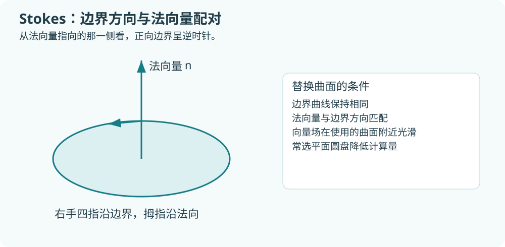

右手四指顺着边界行进，拇指指向曲面法向。从法向指向的那一侧朝曲面看，边界呈逆时针。题目若说“从 $+z$ 侧看逆时针”，对可投到 $xy$ 面的平面片应选 $n_z>0$；顺时针则选 $n_z<0$。

不能只按三维图在屏幕上看起来的顺逆时针判断。若题目写“从某轴方向看”，先将观察位置和朝向翻译清楚，再选法向。

扩展：为什么 Stokes 可以从 Green 得到？

设上侧曲面为 $z=g(x,y)$，其边界投影为平面正向闭曲线。先在曲线积分中代入 $z=g$ 和 $dz=g_xdx+g_ydy$，得到

$$
\oint_\Gamma\mathbf F\cdot d\mathbf r
=\oint_L(P+Rg_x)dx+(Q+Rg_y)dy.
$$

这里 $P,Q,R$ 均已复合 $z=g(x,y)$。按链式法则求平面 Green 的偏导差，可得

$$
\partial_x(Q+Rg_y)-\partial_y(P+Rg_x)
=(Q_x-P_y)+(Q_z-R_y)g_x+(R_x-P_z)g_y.
$$

它正是 $\operatorname{curl}\mathbf F\cdot(-g_x,-g_y,1)$，再利用5.3的向量面积元就得到 Stokes。该推导在足够光滑的图形曲面上直接成立；一般分片曲面可分块，公共边反向抵消。

当 $g=0$ 时只剩旋度第三分量 $Q_x-P_y$，Stokes 就退化为平面 Green 公式。

## 20 计算 Stokes：先展开旋度，再匹配面积元

### 旋度的分量计算

<!-- study:concept|旋度是向量，描述局部环流的轴向与强弱 -->

$$
\operatorname{curl}\mathbf F=\nabla\times\mathbf F
=(R_y-Q_z,\ P_z-R_x,\ Q_x-P_y).
$$

教材也写为 $\operatorname{rot}\mathbf F$。分量顺序与叉积一致，中间分量应是 $P_z-R_x$。

<!-- /study -->

扩展：旋度行列式如何逐项展开？

形式记号为

$$
\nabla\times\mathbf F=
\begin{vmatrix}
\mathbf i&\mathbf j&\mathbf k\\
\partial_x&\partial_y&\partial_z\\
P&Q&R
\end{vmatrix}
=\mathbf i(R_y-Q_z)-\mathbf j(R_x-P_z)+\mathbf k(Q_x-P_y).
$$

第二项有代数余子式的负号，因此最终第二分量为 $P_z-R_x$。这里第二行是求导算子，要作用于第三行对应函数。

例如本地第三次作业填空题4的 $\mathbf A=(xz,y^4,z^2)$：第一分量 $0-0=0$，第二分量 $x-0=x$，第三分量 $0-0=0$，故旋度为 $(0,x,0)$。

### 标准计算步骤

**识别闭曲线及方向 → 求旋度 → 选所张曲面 → 匹配法向 → 用5.3算曲面积分 → 复核符号**。

两种等价写法任选一种，不能混用：

|所用面积|配套公式|
|---|---|
|实际曲面面积元 $dS$|$\operatorname{curl}\mathbf F\cdot\mathbf n\,dS$，其中 $\mathbf n$ 必须单位化|
|投影面积元 $dxdy$|上侧用 $\operatorname{curl}\mathbf F\cdot(-g_x,-g_y,1)dxdy$，下侧取负|

### 例1 水平圆：联系 Green 并核对方向

$L:x^2+y^2=a^2,z=h$，从 $+z$ 侧看逆时针，求 $\oint_L(-y\,dx+x\,dy)$。

**本例知识点**：水平圆选水平圆盘，上侧法向与逆时针边界匹配。

$\mathbf F=(-y,x,0)$，旋度为 $(0,0,2)$。选圆盘法向 $(0,0,1)$，得到 $I=2\pi a^2$。若方向顺时针，结果为 $-2\pi a^2$。

### 例2 倾斜大圆：区分实际面积与投影面积

$L$ 为单位球面与 $x+y+z=0$ 的交线，从 $+z$ 侧看逆时针，求 $\oint_L(y\,dz-z\,dy)$。

**本例知识点**：旋度为常向量、所张面为平面时，可用单位法向乘实际面积；也可用向量面积元投影计算。

$\mathbf F=(0,-z,y)$，旋度为 $(2,0,0)$。选平面内单位圆盘，法向 $\mathbf n=(1,1,1)/\sqrt3$，其 $z$ 分量为正，实际面积为 $\pi$，故

$$
I=(2,0,0)\cdot\frac{(1,1,1)}{\sqrt3}\,\pi=\frac{2\pi}{\sqrt3}.
$$

若改投 $xy$ 面，$z=-x-y$，上侧向量面积元 $(1,1,1)dxdy$；投影椭圆 $x^2+y^2+(x+y)^2\le1$ 的面积是 $\pi/\sqrt3$，所以 $I=2\cdot\pi/\sqrt3$。不能将单位法向直接乘投影面积，否则少了面积修正。

## 21 选简单曲面：边界固定，曲面可以改变

### 换面的条件

在保持同一有向边界的前提下，可选更容易计算的曲面，但新曲面必须可定向、方向匹配，且场在新曲面附近一阶连续可微。不能选穿过场奇点的曲面。

<!-- study:warning|选面自由来自适用条件，并非任何曲面都能替换 -->

两张曲面若都满足 Stokes 条件，旋度通量都等于同一个边界积分。所选面不必是题目给出的球面或抛物面的一部分；平面圆盘往往更简单。

<!-- /study -->

### 例3 两个曲面的交线，改选圆盘：教材例5.2

$\Gamma$ 为 $z=2(x^2+y^2)$ 与 $z=3-x^2-y^2$ 的交线，从 $+z$ 侧看逆时针，求

$$
I=\oint_\Gamma z^3dx+x^3dy+y^3dz.
$$

**本例知识点**：先联立曲面确定边界，再选最简单的所张曲面；旋度的许多分量可能因法向而不贡献。

联立得 $x^2+y^2=1,z=2$。选圆盘 $\Sigma:z=2,x^2+y^2\le1$，取上侧。场 $\mathbf F=(z^3,x^3,y^3)$ 的旋度为 $(3y^2,3z^2,3x^2)$，点积只保留第三分量，因此

$$
I=\iint_D3x^2dxdy
=3\int_0^{2\pi}\int_0^1r^3\cos^2\theta\,drd\theta=\frac{3\pi}{4}.
$$

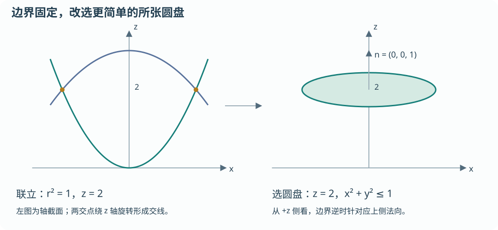

图中上下两张曲面只用来确定交线。选圆盘后，不必分别计算两张曲面的面积元。

扩展：旋度为常向量时，平面面积法怎样简化？

若 $\operatorname{curl}\mathbf F=\mathbf c$ 为常向量，所选面为面积 $A$ 的平面片、单位法向为 $\mathbf n$，则 $I=(\mathbf c\cdot\mathbf n)A$。

但旋度不是常向量时，不能直接把点积当成常数提出积分。可以先利用平面方程化简，若所得函数在该面上确为常数，才使用“常数乘面积”。

## 22 梯度、散度、旋度与三大公式的联系

### 三种运算的输入与输出

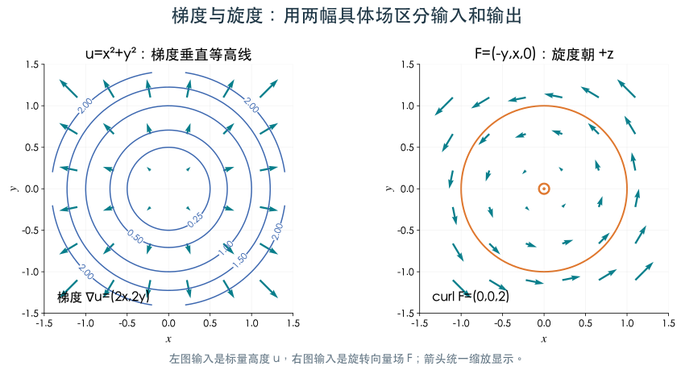

左图 $u=x^2+y^2$ 是标量函数，梯度 $(2x,2y)$ 垂直等高线并指向函数增加方向；右图 $\mathbf F=(-y,x,0)$ 是向量场，旋度为 $(0,0,2)$，表示局部环流的轴向为正 $z$ 方向。

|运算|输入|输出|用途|
|---|---|---|---|
|梯度 $\nabla u=(u_x,u_y,u_z)$|标量函数|向量场|找势函数，使用端点差|
|散度 $\nabla\cdot\mathbf F$|向量场|标量函数|Gauss 转三重积分|
|旋度 $\nabla\times\mathbf F$|向量场|向量场|Stokes 转第二型曲面积分|

### 三个公式，分别连接什么？

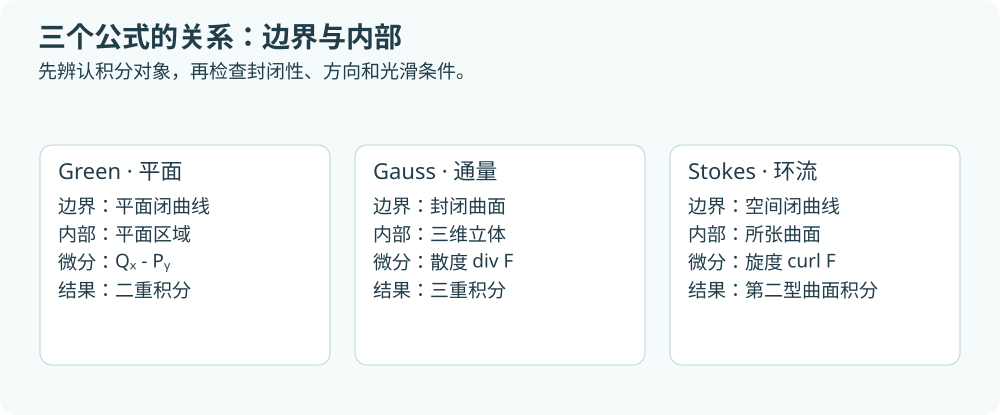

|公式|边界上的量|内部或所张面上的量|方向|
|---|---|---|---|
|Green|平面闭曲线环流|区域内 $Q_x-P_y$ 的二重积分|区域在左侧|
|Gauss|完整封闭面的通量|立体内散度的三重积分|所围立体外侧|
|Stokes|空间闭曲线环流|所张面上旋度的通量|边界与法向符合右手规则|

扩展：两个零恒等式，以及不能误记为零的拉普拉斯算子

若相应函数二阶连续可微，混合偏导相等给出

$$
\operatorname{curl}(\nabla u)=\mathbf0,\qquad
\operatorname{div}(\operatorname{curl}\mathbf F)=0.
$$

例如第一式的第一分量为 $u_{zy}-u_{yz}=0$，其他分量同理；第二式逐项展开后，六个混合偏导成对抵消。

但 $\operatorname{div}(\nabla u)=u_{xx}+u_{yy}+u_{zz}=\Delta u$ 一般不为零，例如 $u=x^2+y^2+z^2$ 时为6。

本节自检：旋度中间分量的符号是否正确？边界方向与法向是否匹配？实际面积和投影面积是否配套？所选曲面是否经过奇点？

## 23 考试中的方法选择

### 曲线积分

1. 先找是否为全微分；能找到势函数，直接算端点差。
2. 若是平面闭曲线，检查 Green 条件及 $Q_x-P_y$ 是否简单。
3. 若是空间闭曲线，检查 Stokes，寻找简单所张曲面。
4. 若是开曲线，比较直接参数化、势函数和补线的复杂度。
5. 若场有奇点，标出其位置；选择参数法或挖洞，不能让定理跨过奇点。

### 曲面积分

1. 先辨认第一型还是第二型：看到 $dS$ 常是标量面积累积；看到有向 $dydz,dzdx,dxdy$ 要判断侧。
2. 封闭外侧优先比较 Gauss 与直接计算。
3. 开放曲面比较补面与合一投影法。
4. 场有奇点时，先核验它是否在所围立体内。
5. 最后核对法向与题目侧是否一致，必要时整体变号。

|公式|原积分|转换后的积分|必要核对|
|---|---|---|---|
|Green|平面闭曲线第二型|平面二重积分|正向边界、域内无未处理奇点|
|Gauss|封闭曲面第二型|三重积分|外侧、完整封闭、内部光滑|
|Stokes|空间闭曲线第二型|旋度的第二型曲面积分|右手匹配、所张曲面附近光滑|
|势函数|开/闭曲线第二型|端点值差|单值势函数存在、路径在定义域内|

<!-- study:warning|使用定理前先核对条件 -->

**每次使用定理先写条件**：“补上某面，取外侧”“场在该区域内光滑”“按给定方向选上侧”等一句话，既帮助自己控制符号，也让解答过程完整。

<!-- /study -->

## 24 自测与解答

**题1** 从 $(0,0)$ 沿直线到 $(2,1)$，求 $\int_L(2x+y)dx+xdy$。

**题2** 单位圆顺时针，求 $\oint_L(-y\,dx+x\,dy)$。

**题3** $\Sigma:z=1-x-y$ 在第一卦限上侧，求场 $(x,y,z)$ 的通量。

**题4** 半径 $a$ 球面内侧，求场 $(x^3,y^3,z^3)$ 的通量。

**题5** $L$ 为 $x^2+y^2=4,z=0$，从 $+z$ 侧看逆时针，求 $\oint_L(-y/2)dx+(x/2)dy$。

**题6** 判断：“在原点外 $P_y=Q_x$，所以原点外任意闭曲线积分都为零。”给出理由。

**题7** 上半球半径1取外侧，场 $(0,0,z+2)$，用补面法求通量。

### 解答

1. $u=x^2+xy$，$u_x=2x+y,u_y=x$，端点差为 $6$；直接取 $x=2t,y=t$ 也得 $\int_0^1 12tdt=6$。
2. 逆时针值 $2\pi$，顺时针结果为 $-2\pi$。
3. 上侧向量面积元 $(1,1,1)dxdy$，点积 $x+y+z=1$，投影三角形面积 $1/2$，故通量 $1/2$。
4. 外侧散度为 $3(x^2+y^2+z^2)$，体积分 $3\cdot4\pi\int_0^a r^4dr=12\pi a^5/5$；内侧为 $-12\pi a^5/5$。
5. 旋度的 $z$ 分量为1，乘圆盘面积 $4\pi$ 得 $4\pi$。
6. 错。穿孔平面不是单连通域；取 $P=-y/(x^2+y^2),Q=x/(x^2+y^2)$，单位圆正向积分为 $2\pi$。
7. 散度为1，半球体体积 $2\pi/3$。底盘外法向朝下、通量 $-2\pi$，半球面通量 $2\pi/3-(-2\pi)=8\pi/3$。

最终复核：方向改变只需对第二型积分整体变号；奇点问题需先处理定义域；补线补面需保留完整的积分账本。这三类检查应贯穿每道题。
