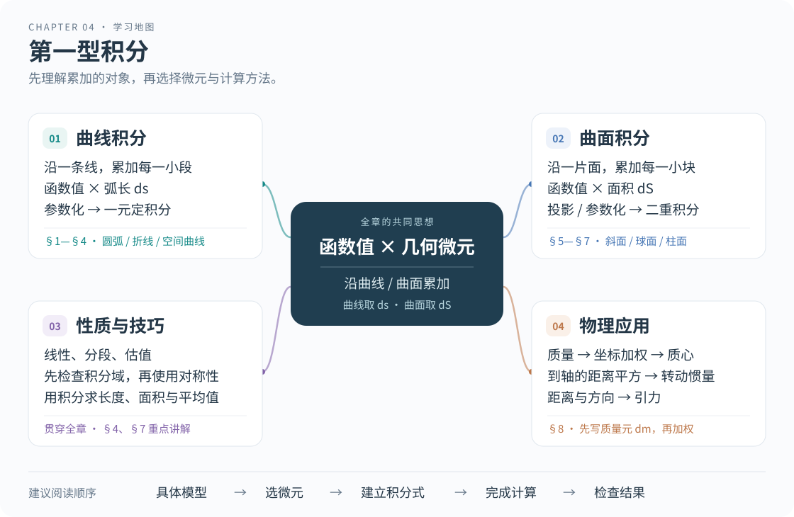

# 第4章 第一型积分

[课程首页](../README.md) · [整章连续阅读](../04_第一型积分_教程.md)

从密度与微元出发，沿曲线和曲面建立积分，再处理几何量与物理应用。

本章按教材的 3 个 Section 组织。先阅读本节教程，再进入对应作业；作业共 14 题，每题包含原题、1—2句话的知识点说明和解题过程。

## Section 学习路线

| Section | 学习目标 | 平时作业 |
|---|---|---|
| [4.1 第一型曲线积分](section1.md) | 理解沿曲线的累积，掌握弧长元、参数法与对称性。 | [作业解读 · 5题](homework1.md) |
| [4.2 第一型曲面积分](section2.md) | 分清实际曲面与投影区域，掌握面积元、投影法和参数法。 | [作业解读 · 6题](homework2.md) |
| [4.3 几何形体上的积分及其应用](section3.md) | 用统一的微元思路计算几何量、质量、质心、转动惯量和引力。 | [作业解读 · 3题](homework3.md) |

## 本章整合

- [章末方法总结与自测](summary.md)
- [期末题型与真题推导](../06_期末题型与复习路线.md)
- [资料依据与覆盖对照](../资料依据与覆盖对照.md)

## 学习地图

图中的01—10是原教程的讲解单元：01—04归入4.1，05—06归入4.2，07—08归入4.3，09—10放在章末总结与自测。
