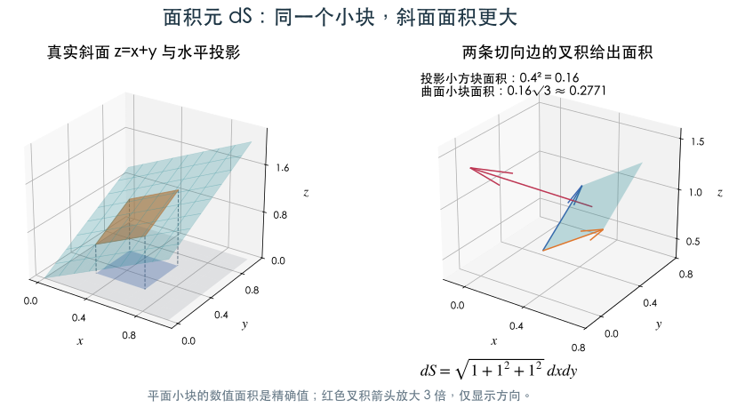
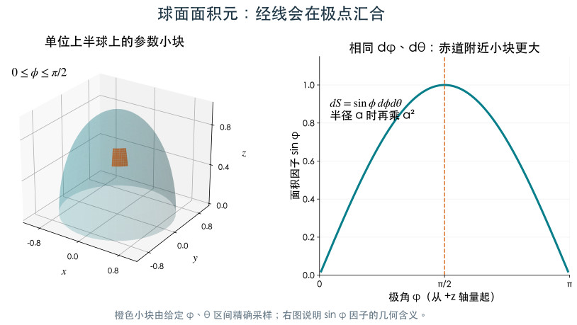
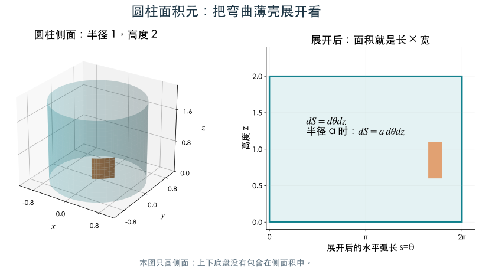
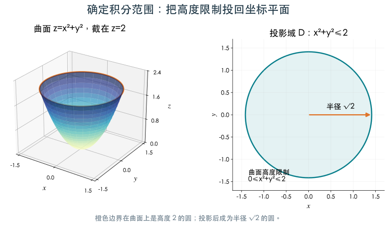

# 4.2 第一型曲面积分

[第4章目录](README.md) · [作业解读（6题）](homework2.md)

> 学习目标：分清实际曲面与投影区域，掌握面积元、投影法和参数法。

## 第一型曲面积分与面积元

曲线部分已经走完，现在把“一小段长度”换成“一小块面积”。本节依次介绍曲面积分、投影面积元与参数面积元，为下一节的例题准备工具。

曲面分成小块，实际面积为 $\Delta S_i$，则

$$
\iint_\Sigma f\,dS=\lim_{\max\operatorname{diam}\Delta\Sigma_i\to0}\sum_i f(M_i)\Delta S_i.
$$

取 $f=1$ 得曲面面积，取面密度得薄壳质量。第一型曲面积分也具有线性、分片相加、估值和方向无关等性质。

### 图形曲面的投影公式

若 $\Sigma:z=g(x,y)$，投影域为 $D$，且曲面可单值表示，则

$$
dS=\sqrt{1+g_x^2+g_y^2}\,dxdy,
$$

$$
\iint_\Sigma f(x,y,z)dS=\iint_D f(x,y,g(x,y))\sqrt{1+g_x^2+g_y^2}\,dxdy.
$$

可类比斜面的实际面积与水平投影面积：坡度越大，修正因子越大。换成 $x=h(y,z)$ 或 $y=k(z,x)$ 时，公式相应换字母。

**用一个可精确测量的小斜面推公式**

图中曲面是 $z=x+y$，投影是单位正方形。橙色小块的投影边长都是0.4，投影面积为0.16。在曲面上，两条边对应向量 $(0.4,0,0.4)$ 与 $(0,0.4,0.4)$。

**向量**是带方向的量，可用分量写成 $(a,b,c)$；两个向量的**叉积**垂直于它们所在平面，其长度等于这两条边构成的平行四边形面积。本例叉积为 $(-0.16,-0.16,0.16)$，长度为 $0.16\sqrt3\approx0.2771$，所以实际小块比投影大。

将0.4改为微小的 $dx,dy$，对一般曲面 $z=g(x,y)$，两条切向边成为 $(1,0,g_x)dx$ 与 $(0,1,g_y)dy$。叉积为 $(-g_x,-g_y,1)dxdy$，取长度就得到面积修正因子 $\sqrt{1+g_x^2+g_y^2}$。这里 $g_x,g_y$ 是固定另一坐标时曲面的两种坡度。

**数值检查**：整个单位方形上的平面 $z=x+y$，投影面积为1，真实面积为 $\sqrt3$。如果计算出1，说明漏了斜面的伸缩。

投影域由**全部限制条件**确定。例如 $z=x^2+y^2,0\le z\le2$ 投影为圆盘 $x^2+y^2\le2$。对整球面投影时，上下半球对应同一圆盘，需要分片或改用球面参数。

### 参数曲面的面积元

设 $\mathbf r(u,v)$ 覆盖曲面一次，则

$$
dS=\lVert\mathbf r_u\times\mathbf r_v\rVert\,dudv.
$$

叉积的长度是两条微小切向边所形成平行四边形的面积。交换 $u,v$ 会使叉积反向，但长度不变，这也说明第一型面积积分与定向无关。

|曲面|参数与范围|面积元|
|---|---|---|
|球面半径 $a$|$x=a\sin\phi\cos\theta,y=a\sin\phi\sin\theta,z=a\cos\phi$|$a^2\sin\phi\,d\phi d\theta$；整球 $0\le\phi\le\pi,0\le\theta\le2\pi$|
|圆柱侧面|$x=a\cos\theta,y=a\sin\theta,z=v$|$a\,d\theta dv$|
|圆锥 $z=kr$|$x=r\cos\theta,y=r\sin\theta,z=kr$|$r\sqrt{1+k^2}\,drd\theta$|
|图形面 $z=g(x,y)$|$\mathbf r(x,y)=(x,y,g(x,y))$|$\sqrt{1+g_x^2+g_y^2}\,dxdy$|

球面公式里的 $\phi$ 是从 $+z$ 轴量起的极角，上半球取 $0\le\phi\le\pi/2$。不要混用纬度参数与极角参数。

**球面读图**：相同的极角宽度 $d\phi$ 与方位角宽度 $d\theta$，在赤道附近形成较宽的小块，在北极附近形成很窄的小块。沿经线的小边约为 $a\,d\phi$；沿纬线的小边约为 $a\sin\phi\,d\theta$。两边互相垂直，相乘得到 $a^2\sin\phi\,d\phi d\theta$。右图画出了面积因子 $\sin\phi$，从极点的0增至赤道的1。

**圆柱读图**：把半径1、高度2的侧面沿一条母线剪开并展开，得到宽 $2\pi$、高2的长方形。橙色块在圆柱与展开图中是同一块：宽度等于弧长 $d\theta$，高度为 $dz$。半径换为 $a$ 后，宽度变成 $a\,d\theta$，所以侧面面积元是 $a\,d\theta dz$。

球面的参数网格会向极点收拢，圆柱的参数网格不会。两个公式的差异可从这两幅图直接看出。

## 曲面积分完整例题

上一节得到面积元，本节按“写曲面与范围 → 选投影或参数 → 替换函数和面积元 → 计算”的同一顺序，练习斜平面、抛物面、球面与圆柱侧面。

### 例5 斜平面上的密度：本地第4章作业填空题3

$\Sigma:x/2+y+z=1$ 在第一卦限的部分，求 $\iint_\Sigma(x+2y+2z+4)dS$。

曲面写成 $z=1-x/2-y$，故 $g_x=-1/2,g_y=-1$，$dS=3dxdy/2$。投影域为 $x\ge0,y\ge0,x/2+y\le1$，三角形面积是 $1$。又在曲面上 $x+2y+2z+4=6$，于是 $I=6\cdot(3/2)\cdot1=9$。

这里先用曲面方程化简被积函数，可避免不必要的逐项积分。

### 例6 抛物面：补充例题

本题为抛物面补充练习；原始作业计算题2为锥面 $z=\sqrt{x^2+y^2}$，见 [4.2 作业解读](../chapter4/homework2.md)。

$\Sigma:z=x^2+y^2,0\le z\le2$，求 $\iint_\Sigma(x^2+y^2)dS$。

投影域是半径 $\sqrt2$ 的圆盘，$dS=\sqrt{1+4x^2+4y^2}\,dxdy$。在投影平面改用极坐标：

左图的橙色边界满足 $z=2$。将它代入 $z=x^2+y^2$，得到 $x^2+y^2=2$。右图是从上往下投影后得到的圆盘：半径 $\sqrt2$，包括边界内部的所有点。因此极坐标范围是 $0\le r\le\sqrt2,0\le\theta\le2\pi$；不是仅沿边界圆做曲线积分。

沿曲面从中心向外走，坡度越来越大，因此同样的投影面积在外圈对应更大的真实曲面面积。式中的 $\sqrt{1+4r^2}$ 正在记录这种变化。

$$
I=\int_0^{2\pi}\int_0^{\sqrt2}r^3\sqrt{1+4r^2}\,drd\theta.
$$

令 $u=1+4r^2$，$r^3dr=(u-1)du/32$，则

$$
I=\frac\pi{16}\int_1^9(u^{3/2}-u^{1/2})du
=\frac\pi{16}\left[\frac25u^{5/2}-\frac23u^{3/2}\right]_1^9
=\frac{149\pi}{30}.
$$

两个因子承担不同工作：$\sqrt{1+4r^2}$ 把投影面积还原为曲面面积，$r$ 把直角坐标面积换成极坐标面积；两者都要保留。

### 例7 球面的平方积分

在整球面 $x^2+y^2+z^2=a^2$ 上，计算 $\iint_\Sigma x^2dS$。

三个平方积分相等，总和为 $a^2\cdot4\pi a^2$，因此 $\iint_\Sigma x^2dS=4\pi a^4/3$。整球上 $\iint_\Sigma xdS=0$，但上半球上 $\iint_\Sigma zdS=\pi a^3$，后者可由球面参数直接验证。

### 例8 圆柱侧面：本地第4章作业填空题5

$\Sigma:x^2+y^2=a^2,0\le z\le h$，求 $\iint_\Sigma x^2dS$。

取 $x=a\cos\theta,y=a\sin\theta,z=v$，$dS=a\,d\theta dv$。结果为

$$
I=a^3\int_0^h dv\int_0^{2\pi}\cos^2\theta\,d\theta=\pi a^3h.
$$

题目只给圆柱侧面，不应添加上下底面。

---

[进入本节作业解读](homework2.md) · [上一节：4.1](section1.md) · [下一节：4.3](section3.md)
