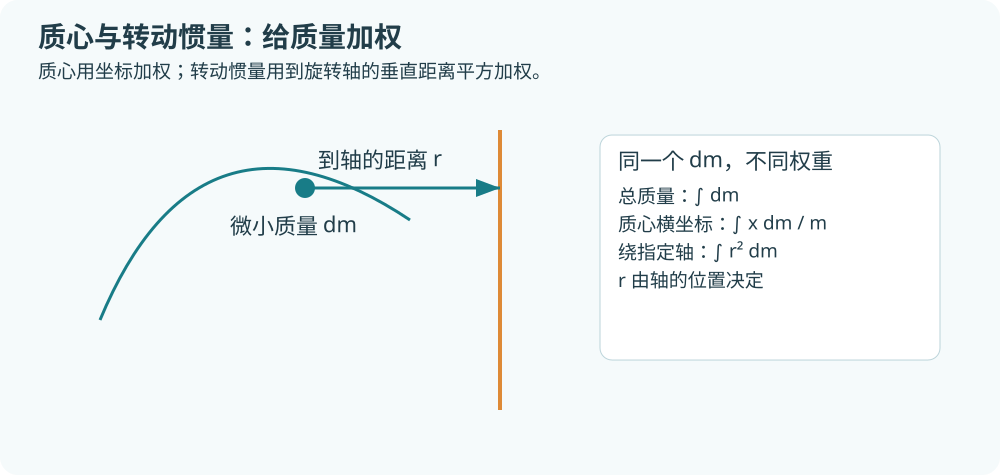
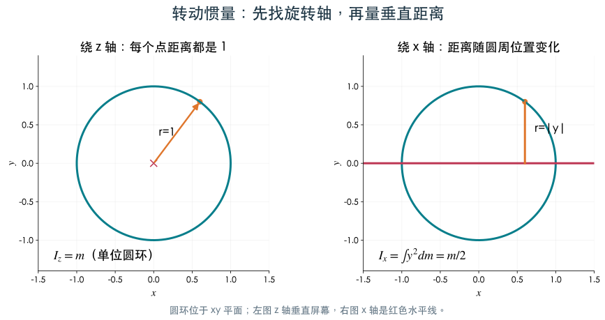
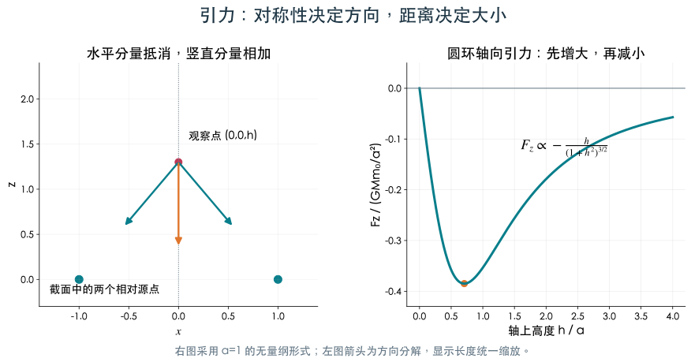

# 4.3 几何形体上的积分及其应用

[第4章目录](README.md) · [作业解读（3题）](homework3.md)

> 学习目标：用统一的微元思路计算几何量、质量、质心、转动惯量和引力。

## 几何形体积分的统一视角

曲线积分与曲面积分都已学过，本节再把它们和以前的一元、二重、三重积分放到一起，整理共同的累加思想、性质与平均值。

教材 §3 将区间、平面区域、立体、曲线与曲面统记为 $G$，相应度量元为 $dG$，统一写作 $\int_G f\,dG$。这是“在相应几何对象上按长度、面积或体积累加”的记号。

在连续、有限度量的常见对象上，线性、可加性、单调性与估值一致。若 $G$ 连通且紧，$f$ 连续，可写积分中值公式 $\int_G f\,dG=f(\xi)m(G)$。这里 $m(G)$ 是总长度、面积或体积。**连通条件不能随意删掉**：不连通的两部分上分别恒取0与1时，平均值可能为1/2，而任何点都不取1/2。

旋转体还可联系此前知识：$y=f(x)\ge0$ 绕 $x$ 轴旋转，体积为 $\pi\int_a^b f(x)^2dx$，旋转侧面积为 $2\pi\int_a^b f(x)\sqrt{1+f'(x)^2}dx$。后一式来自“小圆周 $2\pi f(x)$ × 小母线弧长 $ds$”。

## 质量、质心、转动惯量与引力

有了统一的积分记号，现在回到物理量。本节按“质量 → 质心 → 转动惯量 → 引力”展开：先认清质量元 $dm$，再看不同权重对应什么物理意义。

### 从质点到连续质量分布

左图两个质点位于 $x=0$ 与 $x=2$，质量分别为1和3。质心不是几何中点1，而是 $(0\times1+2\times3)/4=1.5$，向较重的一端偏移。

右图是一根长1的细杆，线密度 $\rho(x)=1+x$，右端比左端密。每一小段的质量是 $(1+x)dx$，总质量为 $3/2$；用位置 $x$ 再加权，一阶矩为 $\int_0^1x(1+x)dx=5/6$，所以质心 $\bar x=5/9$。它略偏向右边，与密度图一致。

“积分坐标乘质量，再除以总质量”是离散加权平均的直接延续。先说明 $dm$ 是什么，再选择坐标权重，质心公式就有了具体含义。

**统一写成质量元 dm**

线、面、体的质量元分别是 $dm=\rho ds,\rho dS,\rho dV$。总质量 $m=\int dm$，当 $m>0$ 时

$$
\bar x=\frac{\int x\,dm}{m},\quad
\bar y=\frac{\int y\,dm}{m},\quad
\bar z=\frac{\int z\,dm}{m}.
$$

质心是质量加权平均。均匀密度可以约掉；非均匀密度必须留在分子、分母。几何对称且密度也对称时，质心在相应对称平面上。

### 例9 均匀抛物面壳的质心：本地第4章作业计算题4

$\Sigma:z=(x^2+y^2)/2,z\le2$，均匀面密度 $\rho$。曲面轴对称，所以 $\bar x=\bar y=0$。投影 $0\le r\le2$，面积元 $dS=r\sqrt{1+r^2}drd\theta$。

$$
m=2\pi\rho\int_0^2r\sqrt{1+r^2}dr
=\frac{2\pi\rho}{3}(5\sqrt5-1).
$$

$$
\int_\Sigma z\,dm
=\pi\rho\int_0^2r^3\sqrt{1+r^2}dr
=\pi\rho\left[\frac15(1+r^2)^{5/2}-\frac13(1+r^2)^{3/2}\right]_0^2
=\frac{\pi\rho}{15}(50\sqrt5+2).
$$

因此

$$
\bar z=\frac{25\sqrt5+1}{5(5\sqrt5-1)}\approx1.118.
$$

结果在 $0$ 与 $2$ 之间，符合质心应在高度范围内的检查。若误把 $dS$ 换成 $dxdy$，得到的是投影薄片的加权值，模型已经改变。

### 转动惯量要先找轴

物体绕轴 $\ell$ 的转动惯量为 $I_\ell=\int r_\ell^2dm$，$r_\ell$ 是点到轴的垂直距离。因此

同一个单位圆环，换旋转轴后距离权重会改变。左图绕垂直于圆环的 $z$ 轴，每个点到轴都为1，所以每一份质量 $dm$ 都乘1。右图绕圆环所在平面内的 $x$ 轴，轴附近点的距离接近0，顶部点的距离为1，权重是 $y^2$。

**为什么平方距离有影响**：两份相同微小质量分别距离轴1与2，它们对转动惯量的贡献之比是 $1^2:2^2=1:4$。因此不能只用“总质量相同”判断转动惯量相同。

$$
I_x=\int(y^2+z^2)dm,\quad I_y=\int(z^2+x^2)dm,\quad I_z=\int(x^2+y^2)dm.
$$

例：半径 $a$、总质量 $m$ 的均匀圆环位于 $z=0$。每个点到 $z$ 轴距离为 $a$，故 $I_z=ma^2$。对称性给出 $I_x=I_y=ma^2/2$。

对通过原点、单位方向向量为 $\mathbf e$ 的轴，距离平方为 $\lVert\mathbf r\rVert^2-(\mathbf r\cdot\mathbf e)^2$。平行轴定理 $I_\ell=I_{\ell_0}+md^2$ 要求 $\ell_0$ 通过质心，两轴平行且相距 $d$。

### 引力应用：理解向量与距离幂

设观察点为 $\mathbf r_0$、质量为 $m_0$，源物体上点为 $\mathbf r$，质量元为 $dm$。源对观察点的引力为

$$
\mathbf F=Gm_0\int\frac{\mathbf r-\mathbf r_0}{\lVert\mathbf r-\mathbf r_0\rVert^3}\,dm.
$$

分母三次方与分子距离向量共同给出“大小与距离平方成反比、方向指向源”。本式适用于观察点与源分离的常规计算；位于源上的奇点需要另作分析。

例如均匀圆环半径 $a$、质量 $M$，轴上点 $(0,0,h)$ 的质量为 $m_0$。水平分量对称抵消，每个源点与观察点距离均为 $\sqrt{a^2+h^2}$，因此

$$
F_z=-\frac{GMm_0h}{(a^2+h^2)^{3/2}}.
$$

$h>0$ 时力向下，$h=0$ 时合力为零。通过对称性先判断分量，能显著减少积分计算。

左图是圆环沿轴线切开的示意：两个相对源点对上方质点的水平拉力互相抵消，竖直分量都向下。绕整圈累加，合力只能沿轴线。

右图将半径取1并除去常数因子，画出 $-h/(1+h^2)^{3/2}$。在圆心 $h=0$ 时力为0；离开圆心后向下的力增大；距离很远时又逐渐减弱。公式既要能给出数值，也应能解释这些图上的变化。

---

[进入本节作业解读](homework3.md) · [上一节：4.2](section2.md) · [章末总结与自测](summary.md)
