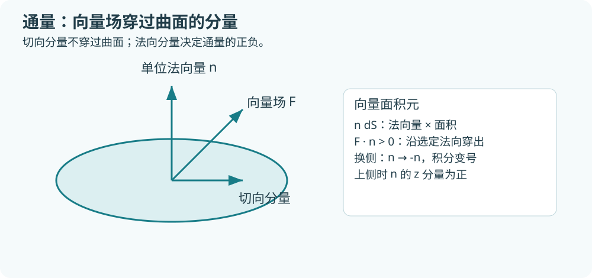
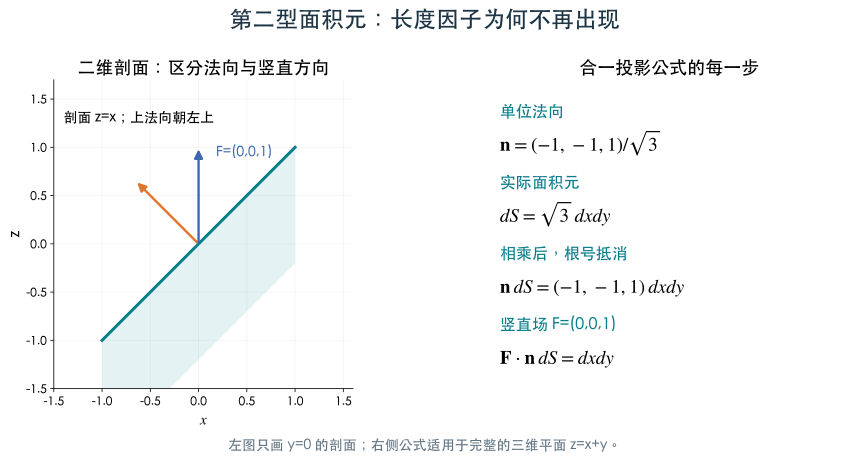

# 5.3 第二型曲面积分

[第5章目录](README.md) · [作业解读（7题）](homework3.md)

> 学习目标：理解通量与曲面定向，掌握合一投影、参数法和两型曲面积分的关系。

## 第二型曲面积分：通量与定向

<!-- study:concept|第二型曲面积分：通量与有向面积元 -->

设流速或其他向量场为 $\mathbf F=(P,Q,R)$，选定曲面单位法向量 $\mathbf n=(n_x,n_y,n_z)$。穿过小曲面块的有向通量为 $\mathbf F\cdot\mathbf n\,dS$，积分记为

$$
\iint_\Sigma\mathbf F\cdot\mathbf n\,dS
=\iint_\Sigma P\,dydz+Q\,dzdx+R\,dxdy.
$$

本章讨论可定向的双侧曲面：可在整片曲面上连续选取一致的单位法向量。莫比乌斯带不能这样选取全局法向，本章的通量公式不直接用于它。

这里 $dydz,dzdx,dxdy$ 表示**有向投影面积元**，对应 $n_xdS,n_ydS,n_zdS$。顺序是循环顺序 $yz,zx,xy$，不是三个无符号面积元随意相加。

<!-- /study -->

### 用“竖直流穿过斜面”检查通量

两图都是 $z=x+y$ 在单位方形上的同一片斜面，场 $\mathbf F=(0,0,1)$ 表示竖直向上。上侧单位法向为 $(-1,-1,1)/\sqrt3$，与场的点积为 $1/\sqrt3$；真实面积为 $\sqrt3$，总通量为1。

右图把法向换为下侧，单位法向整体取负，通量变为 $-1$。场与曲面都没变，改变的是我们约定的正向。这比只记“上侧加号、下侧减号”更能解释公式。

读左图时注意：法向是垂直于斜面的方向，通常不等于竖直方向。右图按顺序列出单位法向、实际面积元、两者相乘及与场点积。归一化分母 $\sqrt3$ 与面积修正 $\sqrt3$ 抵消，留下有向向量面积元 $(-1,-1,1)dxdy$。因此第二型合一投影公式中不应再额外乘一个面积根号。

<!-- study:warning|上侧、下侧与外侧 -->

上侧：$n_z>0$；下侧：$n_z<0$。闭合曲面的外侧指向所围立体之外，内侧与之相反。柱面侧面的外侧通常根据径向判断，不能统一写成“上侧”。

<!-- /study -->

### 图形曲面的合一投影法

<!-- study:result|合一投影公式及定向 -->

对 $z=g(x,y)$ 上侧，有

$$
\mathbf n\,dS=(-g_x,-g_y,1)dxdy,
$$

因此

$$
\iint_\Sigma P\,dydz+Q\,dzdx+R\,dxdy
=\iint_D(-Pg_x-Qg_y+R)dxdy,
$$

场的 $z$ 必须替换为 $g(x,y)$。下侧将整体乘 $-1$。

<!-- /study -->

<!-- study:warning|合一投影中不再乘面积根号 -->

第一型面积元中的根号在这里被单位法向量的归一化分母抵消，所以合一公式不再乘 $\sqrt{1+g_x^2+g_y^2}$。若选其他投影，正 $x$ 法向的 $x=h(y,z)$ 用 $(1,-h_y,-h_z)dydz$，正 $y$ 法向的 $y=k(z,x)$ 用 $(-k_x,1,-k_z)dzdx$。

<!-- /study -->

### 参数法与分面投影

<!-- study:result|第二型曲面积分的参数公式 -->

对参数曲面 $\mathbf r(u,v)$，若 $\mathbf r_u\times\mathbf r_v$ 指向题目指定侧，则通量为

$$
\iint \mathbf F(\mathbf r(u,v))\cdot(\mathbf r_u\times\mathbf r_v)dudv.
$$

若方向相反，整体乘 $-1$。不要给叉积取长度，否则会丢失方向。

<!-- /study -->

分面投影法也可以逐项处理 $P\,dydz,Q\,dzdx,R\,dxdy$：每一项投到对应坐标面，并按相应法向分量决定正负；投影多值则分片。三项转到一个坐标面时，合一投影法通常更短。

### 例8 下侧平面：本地第5章作业第三次选择题2

$\Sigma:x+y+z=1$ 在第一卦限的下侧，求 $\iint_\Sigma zdxdy$。投影域 $D:x,y\ge0,x+y\le1$，下侧 $dxdy$ 是负向投影，所以

$$
I=-\int_0^1\int_0^{1-x}(1-x-y)dydx=-\frac16.
$$

题目只有 $R$ 项，也仍须检查侧的符号。

### 例9 抛物面下侧：补充例题

本题为抛物面补充练习；原始作业第三次填空题2为锥面 $z=\sqrt{x^2+y^2}$，见 [5.3 作业解读](../chapter5/homework3.md)。

$\Sigma:z=x^2+y^2,0\le z\le1$ 下侧，计算 $\iint_\Sigma xdydz+ydzdx+(z-1)dxdy$。

上侧向量面积元为 $(-2x,-2y,1)dxdy$，与场点积为 $-2x^2-2y^2+(x^2+y^2-1)=-r^2-1$。题目取下侧，变为 $r^2+1$，投影是单位圆盘，因此

$$
I=2\pi\int_0^1(r^2+1)rdr=\frac{3\pi}{2}.
$$

### 例10 圆柱侧面直接参数化

$\Sigma:x^2+y^2=a^2,0\le z\le h$ 外侧，$\mathbf F=(x,y,z)$。取 $\mathbf r(\theta,v)=(a\cos\theta,a\sin\theta,v)$，$\mathbf r_\theta\times\mathbf r_v=(a\cos\theta,a\sin\theta,0)$，恰为外向。点积是 $a^2$，故侧面通量为 $2\pi a^2h$。垂直方向的 $z$ 项在侧面没有法向贡献。

---

[进入本节作业解读](homework3.md) · [上一节：5.2](section2.md) · [下一节：5.4](section4.md)
