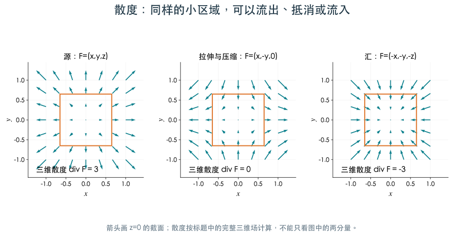
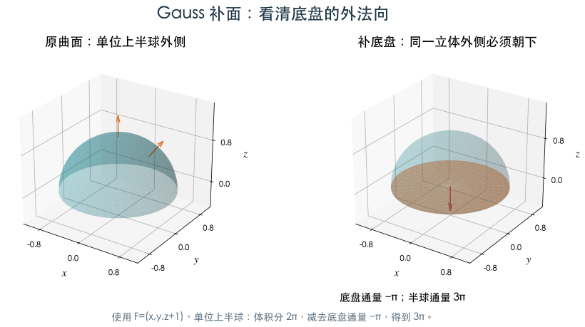
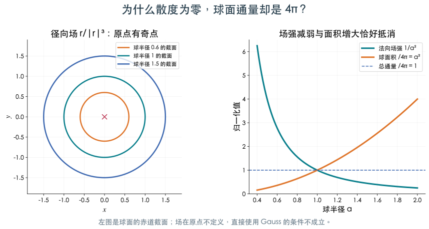

# 5.4 Gauss公式及其应用

[第5章目录](README.md) · [作业解读（4题）](homework4.md)

> 学习目标：通过散度把封闭面的通量化为体积分，处理补面与奇点。

## Gauss 公式：封闭面变为体积分

设 $\Omega$ 的分片光滑边界取外侧，场在包含 $\overline\Omega$ 的开邻域内一阶连续可微，则

$$
\iint_{\partial\Omega}\mathbf F\cdot\mathbf n\,dS
=\iiint_\Omega\left(P_x+Q_y+R_z\right)dV
=\iiint_\Omega\operatorname{div}\mathbf F\,dV.
$$

散度 $\operatorname{div}\mathbf F=P_x+Q_y+R_z$ 衡量单位体积的局部净流出。体内相邻小块的公共面外法向相反，内部通量抵消，只留下边界总通量。

**三幅图的箭头只画 $z=0$ 截面，散度按完整三维场计算**。左图 $\mathbf F=(x,y,z)$ 在每个轴方向都向外拉开，散度是 $1+1+1=3$；小立方体整体净流出。中图 $\mathbf F=(x,-y,0)$ 横向流出、纵向流入，贡献 $1-1+0=0$，场虽然有箭头，净流出仍为0。右图 $\mathbf F=(-x,-y,-z)$ 在三个方向向内汇聚，散度为 $-3$。

在边长1的立方体 $[0,1]^3$ 上，左图的场穿过 $x=1,y=1,z=1$ 三个面，各贡献1；其余三个面因相应分量为0，各贡献0，总通量为3。Gauss 的体积分也给 $3\times1=3$。这是不需要曲面参数就能独立核对的完整小例子。

左图只画原来的上半球面，它有一圈开口，不能直接看作某个立体的全部边界。右图补上底盘形成闭合外表面，底盘的外法向必须朝下，因为半球体内部在底盘上方。

对图中 $\mathbf F=(x,y,z+1)$，单位半球体的散度积分是 $2\pi$；底盘上场的竖直分量为1，但外法向朝下，通量为 $-\pi$。所以原半球面为 $2\pi-(-\pi)=3\pi$。这里用半径1展示数值，对应下面例12的一般半径公式。

### 例11 球面外通量

半径 $a$ 球面外侧，$\mathbf F=(x,y,z)$，散度为3。总通量为 $3\cdot4\pi a^3/3=4\pi a^3$。若题目取内侧，结果为 $-4\pi a^3$。

### 开放曲面补面

若 $\Sigma+B$ 为封闭外侧曲面，则

$$
\iint_\Sigma\mathbf F\cdot\mathbf n\,dS
=\iiint_\Omega\operatorname{div}\mathbf FdV
-\iint_B\mathbf F\cdot\mathbf n\,dS.
$$

补面必须选为该立体的外侧。对上半球封闭成上半球体时，底盘的外法向朝下。

### 例12 半球面补底盘

上半球 $x^2+y^2+z^2=a^2,z\ge0$ 取外侧，场 $\mathbf F=(x,y,z+1)$。散度为3，体积分为 $2\pi a^3$。底盘 $z=0$ 外法向 $(0,0,-1)$，通量为 $-\pi a^2$，所以半球面通量

$$
I=2\pi a^3-(-\pi a^2)=2\pi a^3+\pi a^2.
$$

补面通量为负，减去它时变为加号，这是常见失分点。

### 奇点与挖去小球

$\mathbf F=\mathbf r/\lVert\mathbf r\rVert^3$ 在原点外散度为零，但原点不定义。以原点为中心的半径 $a$ 球面上，$\mathbf F\cdot\mathbf n=1/a^2$，故外通量为 $4\pi$，不能以“散度为零”得零。

若在包含原点的区域内挖小球，Gauss 可用于剩余光滑区域。小球内边界的外法向朝向被挖去的球心；外边界与小球向外的通量相等。本地第三次选择题3就是这一类径向场的球面通量问题。

左图是半径0.6、1、1.5三个球面的赤道截面。右图单独画出法向场强 $1/a^2$ 与球面积除以 $4\pi$ 后的 $a^2$：半径增大时，一个减小、一个增大，乘积保持1。因此每个球的总通量都为 $4\pi$。

这幅图同时给出数值检查与条件检查：通量不为0不是算错了散度，而是原点奇点使“整球体上场光滑”的前提失败。

---

[进入本节作业解读](homework4.md) · [上一节：5.3](section3.md) · [下一节：5.5](section5.md)
